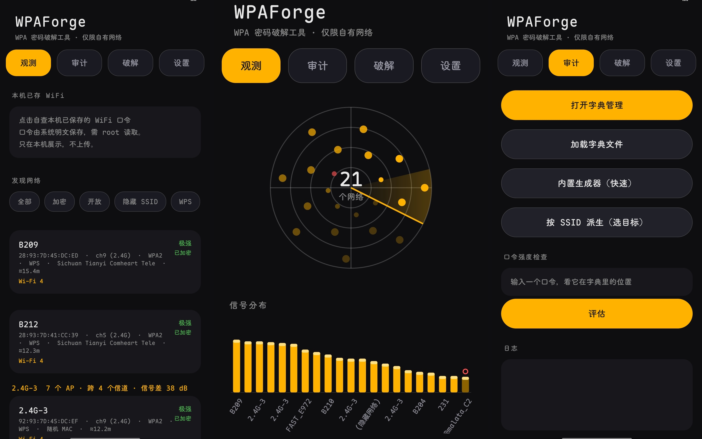
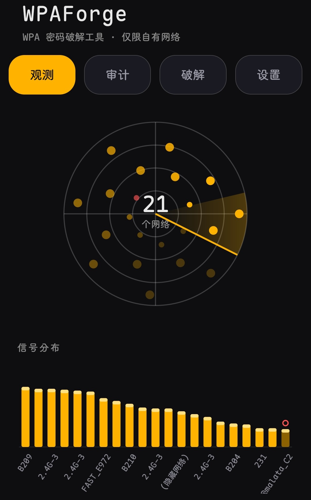

<div align="center">

# WPAForge ⚡

**在手机上，把附近那台路由器的 WPA 密码试出来。**

[](https://github.com/wlmosv-png/wpaforge/releases/latest)
[](https://github.com/wlmosv-png/wpaforge/releases/latest)
[](https://github.com/wlmosv-png/wpaforge/stargazers)
[](LICENSE)
[]()
[]()

**中文** · [English](README_EN.md)



</div>

---

## 为什么是它

常见的 WiFi 破解工具拿一本字典**从头盲试**。WPAForge 不一样——它盯着**你这台手机面前的这一个目标**，现场造最可能命中的密码。

- 🎯 **目标派生** — 按 SSID / BSSID 自动生成几百条「就这个路由器最可能」的候选，字典里没有的它也补上
- ⚡ **智能排序** — 给候选打分重排，对的那条排进前几十位，而不是第五万位
- 🔄 **断点续跑** — 进度实时落盘，锁屏继续跑，中断后从原处接着来
- 🧵 **多目标队列** — 排队自动执行，每项可单独暂停 / 继续
- 🏭 **厂商识别** — 内置 IEEE OUI 表，BSSID 直接显示路由器品牌
- 🔒 **真关联判定** — 只用 4-Way Handshake 完成这一条信号，四条证据同源才算命中，不报假成功

**一句话：字典的质量比体积重要一百倍，而 WPAForge 把「对的那一条」提前到最前面。**

## 安装

> **需要 Root** · Android 8.0+

[**⬇️ 下载最新版 APK**](https://github.com/wlmosv-png/wpaforge/releases/latest)

没有 Root 就别试了——判定依赖 `su + cmd wifi`，Shizuku 与免 Root 通道已移除（原因见 [TECHNICAL-NOTES.md](doc/TECHNICAL-NOTES.md)）。

## 快速上手

```text
1. 打开「观测」页，扫描附近网络，选中你的目标
2. 打开「破解」页，加载字典（或让它现场派生）
3. 点开始，锁屏等结果 —— 命中的密码会直接标出来
```

## 界面预览

<p align="center">
  
  
  
  
</p>

观测 · 审计 · 破解 · 字典 · 设置，五页齐全，自动跟随系统语言。

## 构建

不依赖 Gradle，两段式手工链：

```sh
sh 1-aapt2.sh       # 设备侧：aapt2 编译资源
sh 2-build-dex.sh   # 桌面侧：javac + d8 + 签名
```

产物 `build/out/wpaforge-signed.apk`，构建链完全显式可控。

---

## 使用边界

**仅对自己拥有授权的网络使用**（自有路由器、实验室、授权渗透测试）。对未授权网络发起关联尝试是违法行为，且路由器侧会记录你的 MAC 与时间。

---

## License

Apache License 2.0 — 见 [LICENSE](LICENSE)

设计取舍与踩过的坑（配置复用假阳性、判定时序、`finally` 覆盖结果等）见 [`doc/TECHNICAL-NOTES.md`](doc/TECHNICAL-NOTES.md)。

## Star History

<p align="center">
  <a href="https://star-history.com/#wlmosv-png/wpaforge&Date">
    
  </a>
</p>

## 我的其它项目

| 项目 | 简介 |
|---|---|
| **[TGAutoSign](https://github.com/wlmosv-png/TGAutoSign)** | Telegram 自动签到的 Xposed 模块 —— 多账号槽位、群签到判定、定时计划、多主题界面。任意聊天发 `/jmb` 管理全部目标。 |
| **[apk-index](https://github.com/wlmosv-png/apk-index)** | APK 静态索引与逆向检索工具 —— 解 AXML、逐 dex 建索引，按字符串 / 签名 / 结构反查 hook 点，MCP 接入。 |
