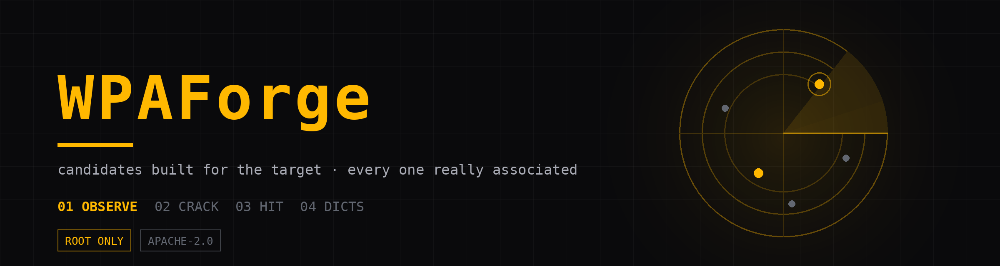
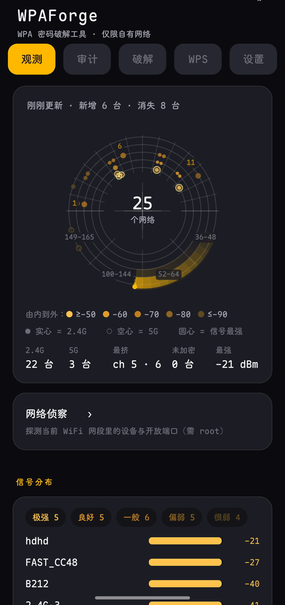
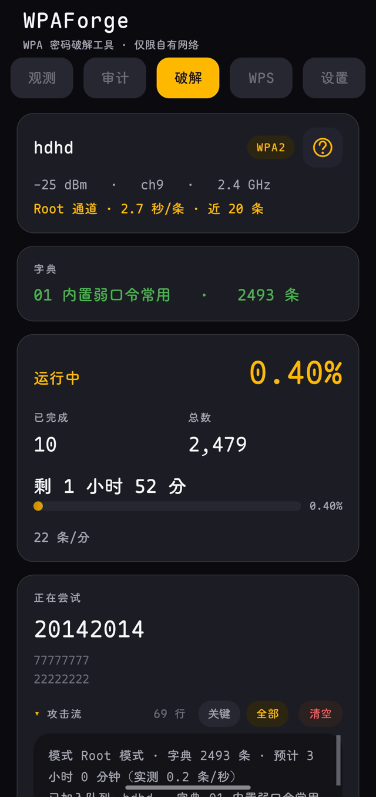
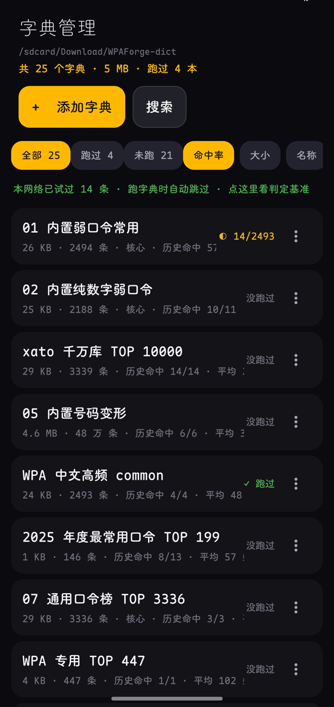
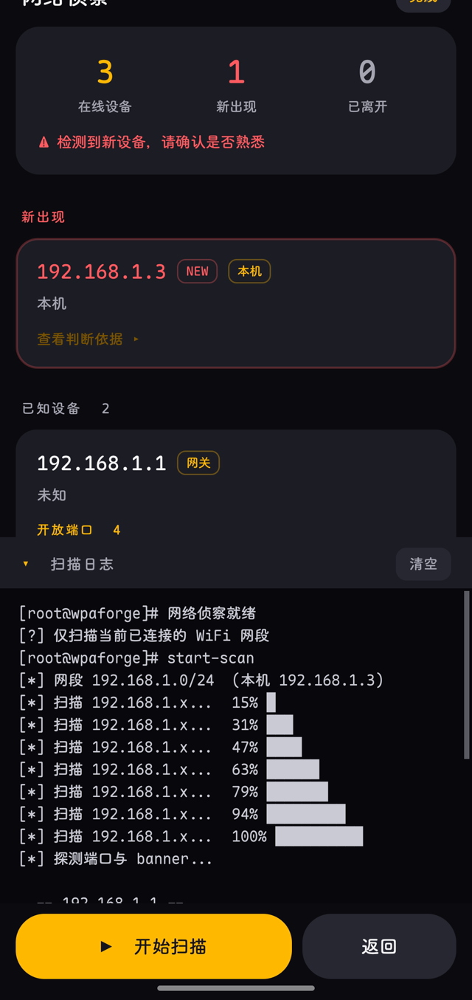
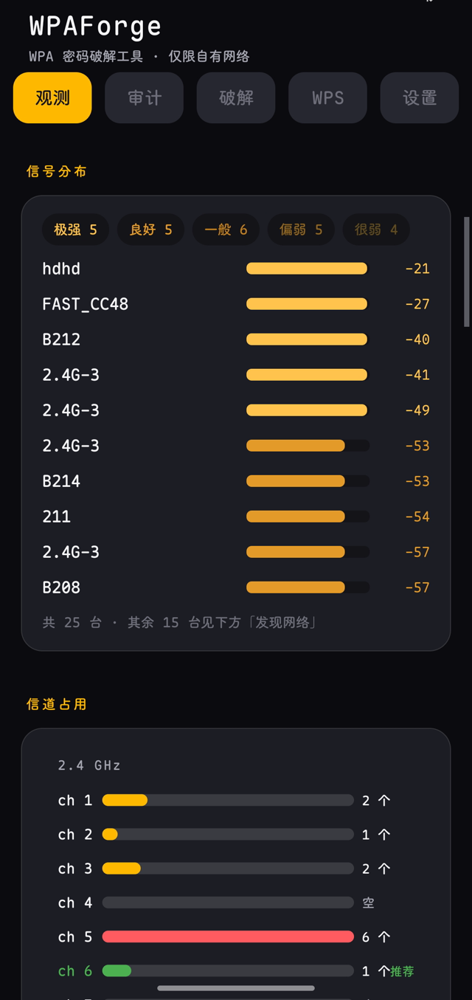
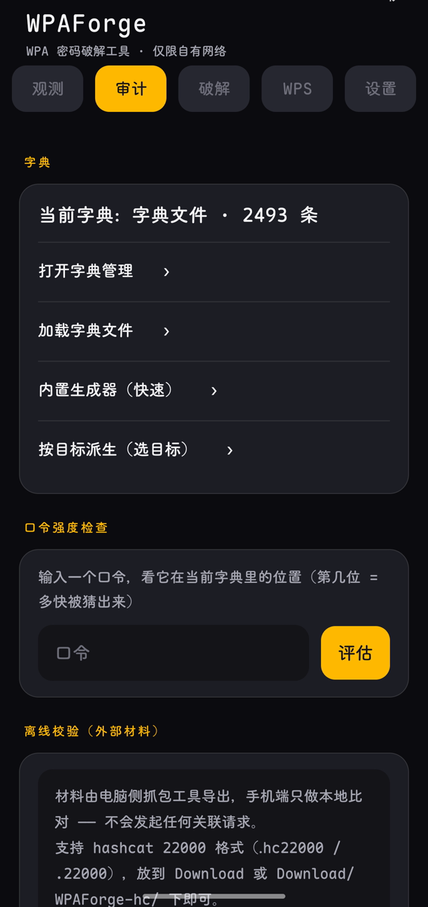
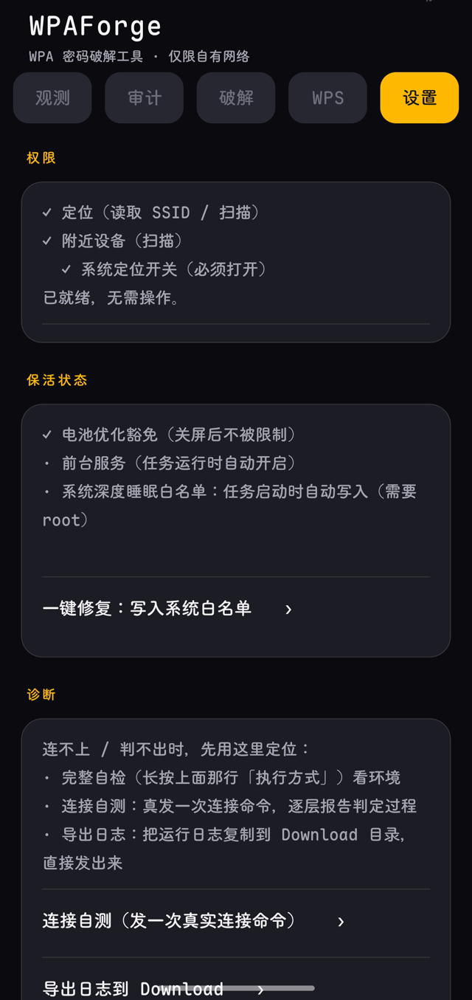

<div align="center">



**在手机上，逐条试出你自己路由器的 WPA 密码。**

<sub>现场生成候选 · 逐条真实关联验证 · 内置精选字典，也能用你自己的</sub>

[](https://github.com/wlmosv-png/wpaforge/releases/latest)
[](https://github.com/wlmosv-png/wpaforge/releases/latest)
[](https://github.com/wlmosv-png/wpaforge/stargazers)
<br>
[](https://wlmosv.dpdns.org/wpaforge/)

<sub>[English](README_EN.md)</sub>

</div>

---

> ### 开始之前
>
> - **需要 Root**（Android 8.0 及以上）：判定依赖 `su + cmd wifi`，没有它就动不了。
> - **只用在你自己拥有、或已获得授权的网络上。** 对别人的网络发起关联尝试是违法行为，
>   路由器那边会记下你的 MAC 和时间。
> - 全程在本机完成，不联网上传任何东西；命中的口令在本机只以密文保存。

## 目录

- [它能做什么](#它能做什么)
- [它怎么找密码](#它怎么找密码)
- [字典：用哪本都行，跑过就看得出好坏](#字典用哪本都行跑过就看得出好坏)
- [判定：宁可说「不确定」，也不报假成功](#判定宁可说不确定也不报假成功)
- [观测：一眼看出该用哪条信道](#观测一眼看出该用哪条信道)
- [快速开始](#快速开始)
- [界面预览](#界面预览)
- [和别的做法比](#和别的做法比)
- [已知限制](#已知限制)
- [安装](#安装)
- [构建](#构建)
- [License](#license)

## 它能做什么

- **按目标现场生成候选**：SSID、厂商、门牌、姓名、生日、手机号都能当依据
- **用内置字典，或用你自己导入 / 下载的字典** —— 两种都支持，跑法完全一样
- 每条候选真实发起一次关联，逐条给结论：**成功 / 密码错 / 不确定**
- 结果按**本机战绩**排序：字典页直接写出「这本在你这里命中几次、平均几条中一次」
- 多目标队列：排好的一串目标依次执行，每个可单独暂停 / 继续
- 观测页：频谱雷达 + 信道占用与建议，该换哪条信道一眼看得出
- 局域网侦察：扫同网段存活主机与常见端口，按厂商归类，报告可导出
- WPS 四层候选（厂商算法 / 内置弱 PIN 表 / 自定义列表 / 完整枚举），含拆半攻击与断点续跑
- 离线校验 `.cap` / `.hc22000`：EAPOL 与 PMKID 两条路径，1 万条约 37 秒
- 字典能搜能合并能编辑（包含 / 前缀 / 后缀 / 正则），大字典编辑不再丢数据
- 锁屏继续跑；被系统杀掉也能续上（进度节流落盘）

## 它怎么找密码

三条路，你挑：

**① 按目标现场生成。** SSID 叫 `FAST_E972`，它就造 `fast_e972`、`faste972`、`fast2026`
这类；线索里填了姓名、生日、手机号，才会造 `zhangwei1990`、`138xxxxxxxx` 这种。
厂商名从 BSSID 查 IEEE 的 OUI 表（打进包里；查不到就留空，不编一个出来）。

**② 用内置字典。** 7 份精选表：通用弱口令、纯数字、WPA 高频榜、中文高频、年度口令……
每一份都写清它为什么值得留着，点开就看得到。

**③ 用你自己的字典。** 导入 txt，或从在线来源直接下载，都行 —— 跟内置表一样跑，
一样记战绩。

**每条候选都要真发一次关联请求。** 快的 1 秒给结论，慢的 5 秒以上；手机一次只能连
一个网络，这是 Android 的限制，绕不过去 —— 所以「先试哪条」比「有多少条」重要得多：
十万条盲试是按天算的，几百条排好序的通常几分钟就完。

## 字典：用哪本都行，跑过就看得出好坏

内置只留精选，不再往里塞几万条的大表（那种表的实际贡献，本机 107 次命中里一次都没验出来过）。
你自己导入的字典和解密主体完全一样：能跑、能合并、也会记战绩。跑过之后，
字典页会写成这样：

```text
01 内置弱口令常用        核心 · 历史命中 57/73 · 平均 2 条中一次
xato 千万库 TOP 10000        历史命中 14/14 · 平均 23 条中一次
```

默认就按「命中率」排序 —— 先跑在你自己的网络里证明有效的那本。这份战绩只读本机
历史的前几列，不解密任何口令。

## 判定：宁可说「不确定」，也不报假成功

每条候选跑完只有三种结论，而且都给得出依据：

| 结论 | 依据 |
|---|---|
| **成功** | 4-Way Handshake 完成，且 SSID / supplicant 状态 / IP **同源于同一行输出** |
| **密码错** | 有可观察的失败证据（例如 AP 重发握手第一帧） |
| **不确定** | 等满时限却什么都没观察到 —— 单独一栏，不混进「密码错」，也不算「已试过」 |

netId 只当**归属证据**：只有本条尝试与状态两侧都拿到非零 netId 且不一致时，才降级为
不确定；取不到或为 0 时一律不否决。

这条是踩过坑之后改的：早期版本出现过系统弹「无法连接到 BTWIFL_0923」、应用却报
「已连上」。现在宁可少报一个成功，也不多报一个假成功。

## 观测：一眼看出该用哪条信道

圆盘就是频谱：上半圆是 2.4G 的 14 条信道，下半圆是 5G 的 4 个频段；半径＝信号强度，
越靠里越强。**同一格里的点越多，那条信道就越挤。**

盘下面直接给结论，不用自己数：

```text
2.4G 25 台   5G 4 台   最挤 ch 5 · 7   未加密 0 台   最强 -20 dBm
```

头部只有一句 `刚刚更新` / `最后更新 N 秒前`；扫到新设备或有人离开时，
会写成 `新增 2 台 · 消失 1 台`。

## 快速开始

```text
1. 打开「观测」页，扫一下附近，选中你的目标
2. 打开「破解」页：让它现场派生，或加载内置 / 自己的字典
3. 点开始，锁屏等结果 —— 命中的口令会直接标出来，可一键复制
```

## 界面预览


<sub>界面速览 —— 观测 → 破解 → 命中 → 字典管理，四步（每张停 2 秒）</sub>

<p align="center">
  
  
  
  
</p>
<p align="center">
  
  
  
  
</p>
<p align="center"><sub>① 观测（频谱雷达）· ② 破解（进度与速率）· ③ 命中（口令 + 一键复制）· ④ 字典管理（按命中率排序 + 历史战绩）<br>⑤ 网络侦察（设备与开放端口）· ⑥ 信号分布与信道推荐 · ⑦ 审计（字典 / 强度 / 离线校验）· ⑧ 设置（权限与保活）</sub></p>

## 和别的做法比

| 做法 | 要什么 | 快不快 | 门槛 |
|---|---|---|---|
| **WPAForge** | 一台 Root 的手机 | 现场派生候选，几百条一般几分钟 | 会点开始就行 |
| 电脑 aircrack-ng + 抓包 | 笔记本 + 支持 monitor 的网卡 + 已抓到的握手包 | 取决于字典，大字典按天算 | 会命令行、会抓包 |
| 手机 Termux 脚本 | 手机上的 Linux 环境 + 外置网卡 | 多数只是替你跑 aircrack | 会折腾环境 |
| 在线字典站 | 把握手包传给别人 | 排队 | 你的包离开了本机 |

它擅长的是「路由器主人自己设的那种密码」；随机 12 位强密码不在它的范围内 ——
那种密码本来就该用 WPA3。

## 已知限制

| 现象 | 原因 | 怎么办 |
|---|---|---|
| 一直在试但拿不到 | 密码不在候选集合里 | 导入自己的字典，或调高候选上限 |
| 一开始就全失败 | 目标开了 WPA3 / PMF，或 WPA2-WPA3 过渡模式 | 单靠关联尝试打不动，别硬啃 |
| 部分 AP 扫不到 | 手机不支持 6GHz，或本机开了随机 MAC | 关掉本机随机 MAC 再扫 |
| 报权限错误 | Root 没给，或 ROM 禁了 `cmd wifi` | 看设置页那 6 步自检 |
| 中途被系统杀掉 | 后台省电策略 | 加白名单；进度会落盘，重开续跑 |
| WPS 目标的「能力」全是未知、没有设备名 | 系统 SELinux 不允许 supplicant 向 root 域回包 | 加一条放行规则，见下一节 |

### WPS 通道（需要 Root）

WPS 页要显示「WPS 设备名 / 能力 / 配对窗口」，只能通过 wpa_supplicant 的控制通道去问它。
部分系统（实测 ColorOS 15 / Android 15）的 SELinux 策略不允许 supplicant 向 root 域回包，
症状是：AP 列表扫得出来，但每个目标的「能力」都是未知、也没有设备名。
WPAForge 会在 WPS 页直接说明这一点，不会静默显示成「没问题」。

放行办法：在任意 Magisk 模块目录下加一个 `sepolicy.rule`，内容一行：

```
allow hal_wifi_supplicant_default magisk unix_dgram_socket sendto
```

重启生效；删掉该文件回车即撤销。

## 安装

> **需要 Root** · Android 8.0+

[**⬇️ 下载最新版 APK**](https://github.com/wlmosv-png/wpaforge/releases/latest)

为什么必须是 Root：判定依赖 `su + cmd wifi`。Shizuku 与免 Root 通道已在 1.9.24 彻底移除
（含代码依赖）—— Shizuku 要在每次连接时借 binder，免 Root 走 `WifiNetworkSpecifier`
则每条候选都会弹一次系统确认框，两者都撑不起逐条遍历。

## 构建

不依赖 Gradle，两段式手工链：

```sh
WP_VERSION_CODE=123 WP_VERSION_NAME=1.9.27 sh 1-aapt2.sh  # 设备侧：aapt2 编译资源（版本号在这一步写入）
sh 2-build-dex.sh                                       # 桌面侧：javac + d8 + 签名（需 WP_FORGE_KS* 变量）
```

产物 `build/out/wpaforge-signed.apk`。`1-aapt2.sh` 里的版本号默认值只作兜底，
发布时必须显式传入，否则会打出与线上倒挂的版本号。

## 想反馈

机型兼容、失败的 AP 特征、功能建议 → [Discussions](https://github.com/wlmosv-png/wpaforge/discussions)；
确认是 bug → [Issue 模板](https://github.com/wlmosv-png/wpaforge/issues/new/choose)。

---

## 使用边界

**仅对自己拥有授权的网络使用**（自有路由器、实验室、授权渗透测试）。对未授权网络发起关联尝试是违法行为，且路由器侧会记录你的 MAC 与时间。

## License

Apache License 2.0 — 见 [LICENSE](LICENSE)

设计取舍与踩过的坑（配置复用假阳性、判定时序、`finally` 覆盖结果等）见 [`doc/TECHNICAL-NOTES.md`](doc/TECHNICAL-NOTES.md)。

---

**如果它帮到你了，回仓库点个 ⭐ —— 这是这个项目唯一的需求清单。**

## Star History

<p align="center">
  <a href="https://star-history.com/#wlmosv-png/wpaforge&Date">
    
  </a>
</p>

## 我的其它项目

| 项目 | 简介 |
|---|---|
| **[TGAutoSign](https://github.com/wlmosv-png/TGAutoSign)** | Telegram 自动签到的 Xposed 模块 —— 多账号槽位、群签到判定、定时计划、多主题界面。任意聊天发 `/jmb` 管理全部目标。 |
| **[apk-index](https://github.com/wlmosv-png/apk-index)** | APK 静态索引与逆向检索工具 —— 解 AXML、逐 dex 建索引，按字符串 / 签名 / 结构反查 hook 点，MCP 接入。 |
