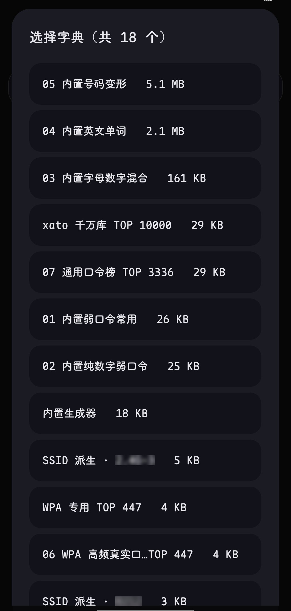
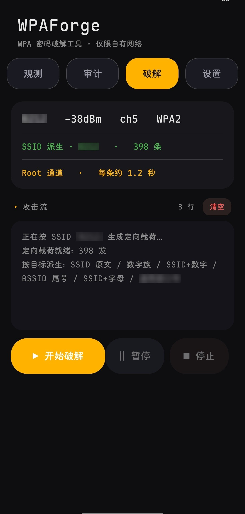

# WPAForge

> Android WPA 密码破解工具 —— 逐条真实关联，带目标派生、智能排序、断点续跑与后台队列。

[](LICENSE)
[]()
[-orange.svg)]()

**中文** | [English](README_EN.md)

> **代码审阅者请看 [`doc/TECHNICAL-NOTES.md`](doc/TECHNICAL-NOTES.md)** ——
> 那里只讲设计取舍和踩过的坑（配置复用假阳性、判定时序、`finally` 覆盖结果等），
> 比本文件更适合评估实现质量。

---

<p align="center">
  
</p>

## 这是什么

WPAForge 通过系统的 `cmd wifi` 接口逐条尝试连接目标网络，用真实的关联结果判断密码是否正确。

和其它同类工具的**关键区别**在于：

| | WPAForge | 常见 WiFi 破解工具 |
|---|---|---|
| **目标派生** | 按 SSID / BSSID 现场生成候选，几百条覆盖常见场景 | 只能按字典行序盲试 |
| **智能排序** | 按目标特征给候选打分重排，最可能的密码排最前 | 无 |
| **断点续跑** | 进度实时存盘，中断后从原位置继续 | 中断即从头再来 |
| **多目标队列** | 排队自动执行，每项可单独暂停/继续 | 一次只能一个 |
| **后台运行** | 前台服务 + 通知栏进度，锁屏继续跑 | 部分支持 |
| **在线字典** | 10 个公开来源一键下载，边下边过滤 | 需自行寻找 |
| **网卡厂商识别** | 内置 IEEE OUI 表（15913 条），直接显示路由器品牌 | 无 |
| **批量与聚合** | 同一 SSID 的多个 BSSID 自动归组 | 平铺重复项 |
| **算法透明** | 加密实现自研，过 RFC 3174 / 2202 / 6070 三套标准向量 | 黑盒 |

---

## 技术亮点

### 1. 单一通道，一套判定

本版**只保留 Root 通道**（`su -c "cmd wifi ..."`）。
Shizuku 与免 Root 已移除，原因写在下面。

所有逻辑共用同一个 **`CrackEngine`**。通道只负责「把一条候选发出去」，
判定完全在引擎里做 —— 这样判定规则只有一份，改一处就全生效。

```
                     ┌──────────────────┐
   Root 通道 ───────→ │   CrackEngine    │ ←── 唯一判定入口
   (su + cmd wifi)   │  （引擎，判定）   │
                     └────────┬─────────┘
                              │
                     ShellChannel (su)
```

**为什么砍掉另外两条通道**

| 通道 | 砍掉的原因 |
|---|---|
| Shizuku | `cmd wifi` 的字符串命令会被 shell 转义与 ROM 差异吞掉，
netId 建不出来，判定永远失败 —— 换 binder 直调能绕开，但那是第二条实现，维护成本翻倍 |
| 免 Root | 走 `WifiNetworkSpecifier` **每一条候选都会弹一次系统确认框**。
这是 Android 的安全边界，不是实现缺陷 —— 无法关闭，实用价值极低 |

与其让用户在三者之间踩坑，不如只留一条**本机实测跑得通**的路。

### 1.1 判定链：同源四条件 + netId 绑定

任何单一信号都不可靠 —— 这是踩过一轮假阳性之后才定下来的。

现行判据要求**四个条件同源于同一行 `WifiInfo`**：

```
① SSID            == 目标
② Supplicant state == COMPLETED      ← 4-Way Handshake 完成
③ IP              有效（排除 0.0.0.0）
④ Net ID          == 本条命令新建出来的 netId
```

四条同行同源，是为了排除「系统回连别的网络」——
别人的网、自己的旧网，都能满足其中任意两三条，但凑不齐四条。

**关于第 ④ 条的一个折中**：`netId` 是系统分配的，但取值有时序敏感问题 ——
命令刚发出时配置未必已建好，可能取到 `-1`。硬卡这一条会导致
**正确密码永远判不出来**（实机出现过：密码正确但 12 秒超时、status 读了 33 轮一次不命中）。

所以实现为**宽松式**：两侧都拿到有效 netId 时才强制相等；
任一侧为 `-1` 视为证据不足，退回前三条件判定。命中时会把证据写进
`confirmedBy`（`supplicant+netId` 表示 netId 也吻合，证据最强）。

### 1.2 实测时序

真机（OnePlus PJX110 / Android 15）单条候选的时间分布：

```
正确密码 → T+1 秒      握手完成、拿到 IP
错误密码 → T+1~6 秒    系统放弃尝试
           T+7 秒      回退到别的已保存 AP
```

这也是「密码错也必须等几秒」的物理原因 —— 不是实现慢，
而是 AP 对错误密码的响应本身就要这个时间。

### 1.3 三个必须处理的坑

**坑一：配置复用导致假阳性**

`cmd wifi connect-network` 对同名网络会**复用已保存的配置**。
目标之前连过的话，不论传什么密码，系统都拿旧配置去连 → 连上了 → 报成功。
实测密码填 `00000000` 也能「命中」。

处理：每条之前删配置，**删完回读校验**；并且开跑前若已连着目标，
先断开以建立干净基线。

**坑二：PMKSA 缓存**

WPA2 有快速重连用的密钥缓存。即便配置被 forget，
`wpa_supplicant` 仍可能在短时间内用缓存密钥连回同一个 AP ——
此时**用错误密码也会连上**。

处理：任务开始时重启一次 WiFi（off → on），强制 wpa_supplicant 重来。
只在开跑时做一次，不影响逐条速度。

**坑三：命中被覆盖成未命中**

`finally` 块在 `return` 之后仍会执行，导致收尾回调发两次，
第二次密码为 `null`，把 `DONE_HIT` 覆盖成 `DONE_MISS`。

处理：加 `finished` 标志。

> 前两个坑原本在**每条通道里各有一份**（因为判定逻辑有两份代码）。
> 这是把所有通道收敛到一个引擎的直接原因。

### 2. 目标派生：往字典里补它没有的

智能排序只能**重排已有的**候选。如果字典里没有 `FAST_E972123` 这种派生密码，它永远排不出来。

`TargetDictBuilder` 根据目标现场造：

```
输入:  SSID = FAST_E972
       BSSID = AA:BB:CC:E9:72:11

生成:  FAST_E972 / fast_e972 / FASTE972          ← 原文与变形
       97297297 / 97297200 / 97297288            ← 数字重复族
       e9721100 / e9721188 / E97211E9            ← BSSID 尾号族
       e972123e / e9721230 / e97212345          ← 片段 + 数字
       E972E972 / e972e972                       ← 片段重复
```

**关键设计**：WPA 强制密码至少 8 位，但用户想设的常是 6–7 位（`972888`、`209209`）。所以对不足 8 位的**自动补几种最可能的填法**，而不是丢弃。

7 个类别按**轮流交错**合并，保证前几十条就覆盖所有类别。

### 3. 智能排序：让对的那条更早出现

不增删任何候选，只重排顺序。评分维度：

| 维度 | 权重 |
|---|---|
| SSID 完全匹配 | +900 |
| SSID 前缀匹配 | +400 |
| SSID 内数字串 | +350 |
| BSSID 尾号 | +320 |
| 通用高频弱密码 | +260 |
| 长度接近 8–11 位 | +60 |
| 纯数字偏好 | +45 |

实测（目标 `B209`，BSSID 尾号 `45DCED`）：

```
输入: aardvark, zzzzzzzzzz, B209123, randompass, 45dced, 12345678

输出: B209123 → 45dced → 12345678 → zzzzzzzzzz → aardvark → randompass
      ↑SSID    ↑MAC尾号  ↑高频弱密码        无关的沉底
```

### 4. 速度：为什么快不起来

AP 对错误密码的响应速度是物理限制。手机一次只能连一个网络，**无法并行** ——
这不是实现问题。

单条候选的成本拆解（真机实测，Root 通道）：

```
forget + list-networks   209 ms
cmd wifi status          100 ms
connect-network 下发      87 ms
logcat 读取              239 ms
--------------------------------
一轮轮询                 ~300 ms
```

正确密码约 1.1 秒判定完成；错误密码要看系统多久放弃尝试，实测 **1~6 秒**。

| 字典大小 | 耗时（按每条 1.2 秒估） |
|---|---|
| 500 | 约 10 分钟 |
| 5,000 | 约 1.7 小时 |
| 50,000 | 约 16.7 小时 |

所以**字典的质量远比体积重要**。这也是目标派生 + 智能排序存在的原因 ——
让命中的那一条尽量排在前几十位，而不是第五万位。

> 界面上显示的是「每条约 X 秒」而不是「X 条/秒」：
> 后者在 0.1 这种量级上看着像「没在动」，而前者才是用户真正关心的等待时长。

---

## 加密实现

WPA 密钥派生按 **IEEE 802.11i** 规范手写实现，不依赖第三方加密库：

```
PMK = PBKDF2-HMAC-SHA1(passphrase, ssid, 4096, 256bit)
PTK = PRF-512(PMK, "Pairwise key expansion",
              min(AA,SPA) || max(AA,SPA) || min(ANonce,SNonce) || max(ANonce,SNonce))
MIC = HMAC-SHA1(KCK, EAPOL_frame_with_MIC_zeroed)[0..16)
```

### 验证结果

| 组件 | 测试向量 | 结果 |
|---|---|---|
| SHA-1 | RFC 3174 / FIPS 180-1 | ✅ 3/3 |
| HMAC-SHA1 | RFC 2202 | ✅ 3/3 |
| PBKDF2-HMAC-SHA1 | RFC 6070 | ✅ 3/3 |
| PMK | Wi-Fi 联盟公开向量 | ✅ 1/1 |

全部测试（**346 项 / 20 个测试类**，全部通过）：

```
SelfTest             加密算法（SHA-1 / HMAC-SHA1 / PBKDF2，RFC 向量）
SupplicantParserTest WifiInfo 行解析（COMPLETED / IP / netId）
StatusParseTest      cmd wifi status 解析，含诱饵行
DecoyLineTest        诱饵行回归（<unknown ssid> + COMPLETED + Net ID: -1）
FalsePositiveTest    假阳性防线（回连别的网 / netId 不符 / 空输入）
NetIdLineTest        list-networks 行解析（含空格 SSID）
PrivScanTest         特权扫描输出解析（中文 SSID、含空格、隐藏网络）
RuleTest             规则字典解析与展开
SortTest             智能排序
TargetDictTest       目标派生
SsidGroupTest        同 SSID 多 AP 聚合
OuiTest              OUI 厂商查询（随机化 MAC 判定、BSSID 写法归一）
E2ETest              握手比对端到端
VerdictFlowTest      判定流程
WatcherLogicTest     事件判定
WifiStateLogTest     状态机日志解析
WpaLogTest           wpa_supplicant 日志解析
SpecifierTest        判定语义（超时 / SSID 不匹配**绝不**判成功）
PersistTest          候选生成 → 落盘 → 读回一致性
AttributionTest      归因（哪一层确认了结果）
```

纯逻辑与 Android 解耦，**可在桌面 JVM 上直接跑**（javac + java，不需要模拟器）。

`SpecifierTest` 与 `FalsePositiveTest` 是防回归的关键 —— 它们把判定语义
写死成测试，确保「超时不算成功」「回连别的网不算命中」这类规则
不会被后续改动破坏。

---

## 功能

```
观测页   扫描周边网络 · 筛选（全部/加密/开放/隐藏/WPS）· 雷达扫描
         信号柱状图 · 信道占用与换信道建议 · 带宽与 Wi-Fi 代际
         网卡厂商识别（IEEE OUI）· 同 SSID 多 AP 聚合 · 已存 WiFi 自查
审计页   内置生成器 · 按 SSID 派生 · 加载字典 · 密码强度检查
破解页   选目标 · 选字典 · 队列 · 三层进度条 · 逐行着色的攻击流日志
         暂停/继续/停止 · 断点续跑 · 后台运行
字典管理 新建(普通/规则) · 导入 · 在线下载 · 合并 · 查看 · 编辑 · 统计
设置页   通道状态 · 权限 · 连接自测 · 导出日志 · 语言 · PIN 锁
         长按通道行看完整检测证据
关于页   项目介绍 · 作者链接 · 使用边界
```

**界面语言**：自动跟随系统（中文系统显示中文，其余显示英文），也可在设置里手动切换。

**候选的三层策略**：

```
第 1 层  目标派生     ~500 条   按 SSID/BSSID 现场造候选
第 2 层  智能排序     全量      按目标特征重排
第 3 层  字典原序     全量      兜底
```

**进度与恢复**：`offset` 在每条候选出结论后落盘（按 ≥2 秒 或 ≥20 条节流），
命中/暂停/停止则立即落盘。系统回收进程后可从原位置继续。

---

## 界面预览

> 截图取自已安装的 1.9.0（OnePlus PJX110 / Android 15），裁去状态栏与手势条。

<p align="center">
  
  
  
  
  
  
  
  
</p>

<p align="center"><sub>依次：
　1. 观测页 · 雷达扫描与信号分布
<br>　2. 观测页 · 厂商识别、随机化 MAC 标注、同 SSID 多 AP 聚合
<br>　3. 观测页 · 信道占用与换信道建议
<br>　4. 审计页 · 字典来源与口令强度检查
<br>　5. 字典管理 · 列表与统计
<br>　6. 破解页 · 三层进度条与攻击流日志
<br>　7. 破解页 · 队列与任务状态
<br>　8. 设置页 · 通道状态与诊断入口</sub></p>

---

## 构建

本项目**不依赖 Gradle**。构建链是手工两段式——因为 `aapt2` 与 `d8` 在 Android 上是 arm64 原生二进制，桌面侧跑不了；而桌面侧有 javac。

```sh
# 第一段：Android 侧（aapt2 编译资源 + link 出 base.apk）
sh 1-aapt2.sh

# 第二段：桌面侧（javac + d8 + 组装 + 签名）
sh 2-build-dex.sh
```

产物：`build/out/wpaforge-signed.apk`

**为什么这么设计**：省去 SDK 下载与网络依赖，构建链完全显式可控。代价是要两段跑。

### 目录结构

```
app/src/main/
├── AndroidManifest.xml
├── assets/builtin/
│   ├── *.txt                     内置弱口令表（首次启动释放到设备）
│   └── oui.txt                   IEEE OUI 厂商表（15913 条，419 KB）
├── res/                          图标、字符串
└── java/io/github/wlmosv_png/wpaforge/
    ├── MainActivity.java         主界面（四页签）
    ├── DictActivity.java         字典管理
    ├── AboutActivity.java        关于页
    ├── CrackService.java         前台服务（队列执行、断点续跑）
    ├── Prefs.java                设置与实测速率样本
    ├── L.java                    双语文案层
    ├── Ver.java                  版本号（唯一来源，从 PackageManager 读）
    ├── core/NetRecord.java       网络模型
    ├── scan/
    │   ├── Scanner.java          扫描（广播 + 轮询双路）
    │   ├── PrivScanReader.java   特权通道读系统扫描结果
    │   ├── ChannelAnalyzer.java  信道占用与推荐
    │   ├── SsidGroup.java        同 SSID 多 AP 聚合
    │   ├── ScanDetail.java       带宽 / Wi-Fi 代际（反射降级）
    │   └── OuiLookup.java        IEEE OUI 厂商查询
    ├── audit/
    │   ├── CrackEngine.java      判定引擎（唯一判定入口）
    │   ├── NetworkWatcher.java   系统网络事件监听
    │   ├── SupplicantParser.java WifiInfo 行解析
    │   ├── StatusParser.java     cmd wifi status 解析
    │   ├── ListNetworksParser.java  list-networks 行解析
    │   ├── WifiStateLog.java     状态机日志读取
    │   ├── WpaLogReader.java     wpa_supplicant 日志解析
    │   ├── WpaCore.java          SHA-1 / HMAC-SHA1 / PBKDF2
    │   ├── TargetDictBuilder.java 目标派生
    │   ├── SmartSorter.java      智能排序
    │   ├── DictGenerator.java    内置生成器
    │   ├── DictStore.java        字典仓库
    │   ├── DictRule.java         规则字典展开
    │   ├── DictSources.java      在线字典源（SecLists 镜像）
    │   ├── BuiltinDicts.java     内置字典释放
    │   ├── TaskQueue.java        任务队列持久化
    │   ├── HistStore.java        破解历史
    │   ├── EnvDiagnostics.java   全链路环境诊断
    │   └── RootProber.java       通道可用性探测
    └── ui/
        ├── RadarSweep.java       雷达扫描动画
        ├── SignalBars.java       信号柱状图
        ├── ChannelBars.java      信道占用条
        ├── StagedProgress.java   三层进度条（缓动 + 流光）
        ├── NetDialog.java        应用内弹窗（暗色圆角）
        ├── AuthorCard.java       作者卡片
        └── ThinProgress.java     细进度条
```

---

## 权限

| 权限 | 用途 |
|---|---|
| `NEARBY_WIFI_DEVICES` | Android 13+ 读取扫描结果 |
| `ACCESS_FINE_LOCATION` | Android 12 及以下读取扫描结果 |
| `FOREGROUND_SERVICE` | 后台破解 |
| `POST_NOTIFICATIONS` | 进度通知 |

**root 权限**：破解功能必需。用于调用 `cmd wifi` 驱动连接。
应用启动时会自动申请上述运行时权限；被永久拒绝时设置页会给出
「去系统设置里允许」入口。

---

## 使用边界

**仅对自己拥有授权的网络使用**（自有路由器、实验室、授权渗透测试）。

WPAForge 会向目标 AP 发起**真实的关联请求**。对自有网络是自查；对未授权网络：

- 是违法行为
- 路由器侧会记录失败尝试（含 MAC 与时间）
- 长时间高频尝试可能造成 AP 连接表压力

请自行确保对目标网络拥有明确授权。

---

## 已知限制

| 项 | 说明 |
|---|---|
| **仅 Root** | 执行通道固定为 `su + cmd wifi`，不支持 Shizuku 与免 Root |
| **6GHz 未实机验证** | 代码里有频段判断路径，但测试机扫不到 6GHz 网络 |
| **WPS 只看不连** | 只做识别与筛选，未实现 PIN 穷举 |
| **厂商名依赖 IEEE 表** | 表中未收录的 OUI 显示空白，不做猜测 |
| **随机化 MAC 无法溯源** | Android 10+ 默认对每个 SSID 生成随机 MAC，
协议层面就不含厂商信息 |
| **单通道串行** | 手机一次只能连一个网络，无法并行尝试 |

---

## 内置字典来源

`assets/builtin/` 中的基础字典来自**公开的弱密码统计数据集**与通用规律生成表（弱密码排行、数字规律、字母数字组合、常见英文词频）。这些是社区长期公开的安全研究数据，不是任何单一作品的原创内容。

在线字典功能从 [SecLists](https://github.com/danielmiessler/SecLists)（MIT 许可）等公开项目下载，数据落于用户本机，本仓库不包含这些数据。

`assets/builtin/oui.txt` 取自 **IEEE 官方 OUI 登记表**
（[standards-oui.ieee.org](https://standards-oui.ieee.org/oui/oui.txt)，MA-L 段），
按网络设备关键词裁剪为 15913 条，仅用于显示网卡厂商名。
表中未收录的地址显示空白，不做推测。

---

## 许可

Apache License 2.0 — 见 [LICENSE](LICENSE)

## 作者

**wlmosv**

- GitHub: https://github.com/wlmosv-png
- Telegram: [@wlmosv_bunny](https://t.me/wlmosv_bunny)

### 其它项目

**[TGAutoSign](https://github.com/wlmosv-png)** — Telegram 自动签到的 Xposed 模块。多账号槽位、群签到判定、定时计划、多主题界面。管理入口：任意聊天发 `/jmb`。

**[apk-index](https://github.com/wlmosv-png)** — APK 静态索引与逆向检索工具。解 AXML、逐 dex 建索引、按字符串/签名/结构反查 hook 点。
