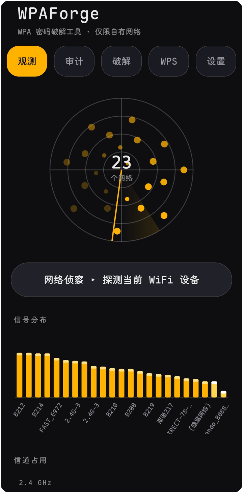
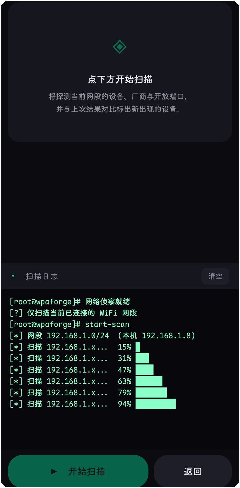
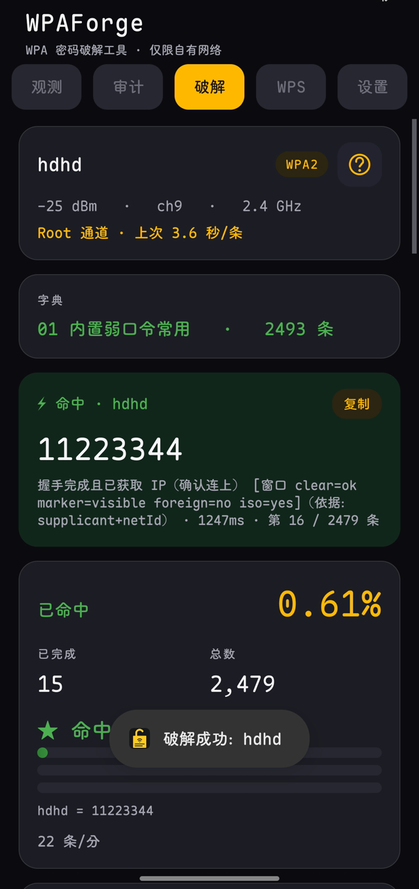
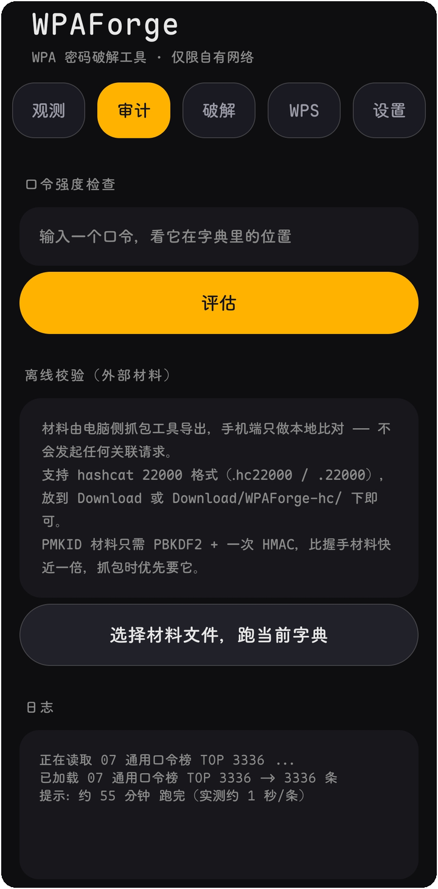
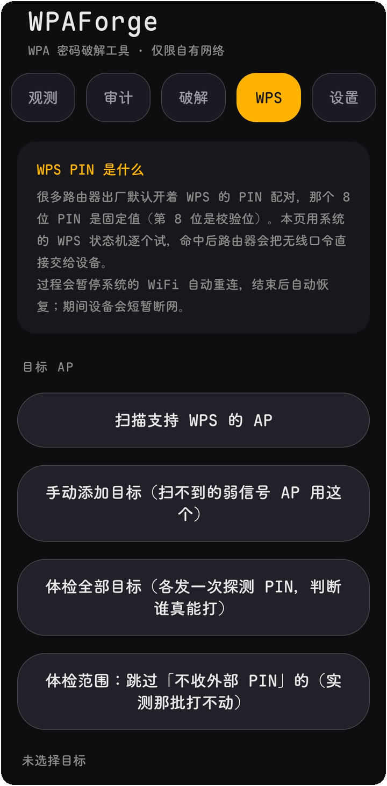
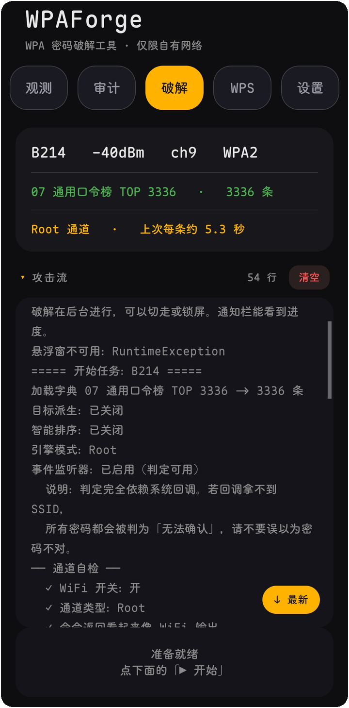

<div align="center">

# WPAForge ⚡

**在手机上，把附近那台路由器的 WPA 密码试出来。**

[](https://github.com/wlmosv-png/wpaforge/releases/latest)
[](https://github.com/wlmosv-png/wpaforge/releases/latest)
[](https://github.com/wlmosv-png/wpaforge/stargazers)
[](LICENSE)
[]()
[]()

**中文** · [English](README_EN.md) · [🎬 完整演示](https://wlmosv.dpdns.org/wpaforge/#demo) · [B站](https://www.bilibili.com/video/BV1b1np6YE7U) · [官网](https://wlmosv.dpdns.org/wpaforge/) · [下载](https://github.com/wlmosv-png/wpaforge/releases/latest) · [讨论](https://github.com/wlmosv-png/wpaforge/discussions)


<sub>界面速览 —— 观测 → 选目标 → 字典 → 破解，四步</sub>


</div>

---

## 它怎么找密码

不翻大字典。先猜 —— 按你这台路由器可能被设成什么，造几百条，排好序，从上往下试。
字典是备用的，不是主力。

**猜，是有依据的。** SSID 叫 `FAST_E972`，它会现场造出 `fast2026`、`FAST#2026`、
`e972e972`、`fast@2026` 这些，现成字典里没有。厂商名从 BSSID 查 IEEE 的 OUI 表得出
（419 KB / 15913 条打进包里），查不到就留空，不编一个出来。

**每条都要真发一次关联请求。** 快的 AP 1 秒给结论，慢的 5 秒以上。手机一次只能连
一个网络，这是 Android 的限制，绕不过去 —— 所以候选的质量比数量重要得多：十万条
盲试是按天算的，几百条精准的通常几分钟就完。

**判成功只认一种证据：4-Way Handshake 完成。** SSID、supplicant 状态、IP 三项
必须**同源于同一行输出**，缺一条就不算。netId 是**归属证据**而不是必要条件：
只有本条尝试与状态两侧都拿到有效非零 netId 且不一致时，才降级为「未确认」
（既不算成功，也不算密码错）；取不到或为 0 时一律不否决。宁可报「不确定」，
也不报一个假成功 —— 这条是踩过坑之后改的：早期版本出现过系统弹
「无法连接到 BTWIFL_0923」、App 却报「已连上」的情况。

**锁屏继续跑，中断能接上。** 进度持续落盘（节流写，最多 20 条一次），被系统杀掉也不丢。

<p align="center">
  <a href="https://wlmosv.dpdns.org/wpaforge/#demo"></a>
</p>
<p align="center"><sub>▶ 真机录屏 · 第 11 条候选命中（10 秒试看）—— <a href="https://wlmosv.dpdns.org/wpaforge/#demo">完整 60 秒带配乐版</a> ｜ <a href="https://www.bilibili.com/video/BV1b1np6YE7U">B站（带弹幕）</a></sub></p>

## 还有什么

- 多目标队列：排好的一串目标依次执行，每个可单独暂停 / 继续
- 局域网侦察：连上目标后扫同网段存活主机与常见端口，按厂商归类，出可导出的报告
- 观测页：信道占用图给出换信道建议，列出带宽与 Wi-Fi 代际，可按 WPS 筛选
- 连接可控：同名 SSID 有多个 AP 时用 `-b` 锁定你选中的那一条；可开启每次尝试换随机 MAC
- 本机自查：读手机里已保存的 WiFi，给出每条密码在常见口令表里的位次
- WPS 攻击（独立页）：扫描阶段就判「打不打得动」，判据以 `km=WPS` / `WPS-M2D` 为准；
  候选四层（厂商算法 / 内置弱 PIN 表 / 自定义列表 / 完整枚举），另有拆半攻击与断点续跑
- 离线校验：导入 `.cap` / `.hc22000`，EAPOL 与 PMKID 两条校验路径，1 万条约 37 秒
- 字典管理：内容搜索（包含 / 前缀 / 后缀 / 正则）、长按多选合并、大字典编辑不再丢数据

## 安装

> **需要 Root** · Android 8.0+

[**⬇️ 下载最新版 APK**](https://github.com/wlmosv-png/wpaforge/releases/latest)

没有 Root 就别试了——判定依赖 `su + cmd wifi`。Shizuku 与免 Root 通道已在 1.9.24 彻底移除（含代码依赖）：
Shizuku 要在每次连接时借 binder，免 Root 走 `WifiNetworkSpecifier` 则每条候选都会弹一次系统
确认框——两者都撑不起逐条字典遍历。

## 快速上手

```text
1. 打开「观测」页，扫描附近网络，选中你的目标
2. 打开「破解」页，加载字典（或让它现场派生）
3. 点开始，锁屏等结果 —— 命中的密码会直接标出来
```

## 界面预览

<p align="center">
  
  
  
  
</p>
<p align="center">
  
  
  
  
</p>
<p align="center"><sub>① 观测 · ② 网络侦察 · ③ 字典管理 · ④ 字典内容 · ⑤ 口令强度与离线校验 · ⑥ WPS · ⑦ 破解 · ⑧ 命中</sub></p>

## 构建

不依赖 Gradle，两段式手工链：

```sh
WP_VERSION_CODE=113 WP_VERSION_NAME=1.9.26 sh 1-aapt2.sh  # 设备侧：aapt2 编译资源（版本号在这一步写入）
sh 2-build-dex.sh                                       # 桌面侧：javac + d8 + 签名（需 WP_FORGE_KS* 变量）
```

产物 `build/out/wpaforge-signed.apk`，构建链完全显式可控。`1-aapt2.sh` 里的版本号默认值只作兜底，
发布时必须显式传入，否则会打出与线上倒挂的版本号。

## 和其他做法比

| 做法 | 要什么 | 快不快 | 门槛 |
|---|---|---|---|
| **WPAForge** | 一台 Root 的手机 | 现场派生候选，几百条一般几分钟 | 会点开始就行 |
| 电脑 aircrack-ng + 抓包 | 笔记本 + 支持 monitor 的网卡 + 已抓到的握手包 | 取决于字典，大字典按天算 | 会命令行、会抓包 |
| 手机 Termux 脚本 | 手机上的 Linux 环境 + 外置网卡 | 多数只是替你跑 aircrack | 会折腾环境 |
| 在线字典站 | 把握手包传给别人 | 排队 | 你的包离开了本机 |

取舍说清楚：它擅长「路由器主人设的那种密码」，不擅长「随机 12 位强密码」—— 后者本来就该上 WPA3。

## 它什么时候会失败

先把话说在前面，这样你不会把它当 bug 到处骂：

| 现象 | 原因 | 怎么办 |
|---|---|---|
| 一直在试但拿不到 | 密码不在候选集合里 | 导入自己的字典，或调高候选上限 |
| 一开始就全失败 | 目标开了 WPA3 / PMF，或 WPA2-WPA3 过渡模式 | 单靠关联尝试打不动，别硬啃 |
| 部分 AP 扫不到 | 手机不支持 6GHz，或本机开了随机 MAC | 关掉本机随机 MAC 再扫 |
| 报权限错误 | Root 没给，或 ROM 禁了 `cmd wifi` | 看设置页那 6 步自检 |
| 中途被系统杀掉 | 后台省电策略 | 加白名单；进度会落盘，重开续跑 |

## 想要什么，去哪儿说

机型兼容反馈、失败的 AP 特征、功能建议 → [Discussions](https://github.com/wlmosv-png/wpaforge/discussions)；
明确的 bug → [Issue 模板](https://github.com/wlmosv-png/wpaforge/issues/new/choose)。

---

## 使用边界

**仅对自己拥有授权的网络使用**（自有路由器、实验室、授权渗透测试）。对未授权网络发起关联尝试是违法行为，且路由器侧会记录你的 MAC 与时间。

---

## License

Apache License 2.0 — 见 [LICENSE](LICENSE)

设计取舍与踩过的坑（配置复用假阳性、判定时序、`finally` 覆盖结果等）见 [`doc/TECHNICAL-NOTES.md`](doc/TECHNICAL-NOTES.md)。

---

**如果它帮到你了，回仓库点个 ⭐ —— 这是这个项目唯一的需求清单。**

## Star History

<p align="center">
  <a href="https://star-history.com/#wlmosv-png/wpaforge&Date">
    
  </a>
</p>

## 我的其它项目

| 项目 | 简介 |
|---|---|
| **[TGAutoSign](https://github.com/wlmosv-png/TGAutoSign)** | Telegram 自动签到的 Xposed 模块 —— 多账号槽位、群签到判定、定时计划、多主题界面。任意聊天发 `/jmb` 管理全部目标。 |
| **[apk-index](https://github.com/wlmosv-png/apk-index)** | APK 静态索引与逆向检索工具 —— 解 AXML、逐 dex 建索引，按字符串 / 签名 / 结构反查 hook 点，MCP 接入。 |

