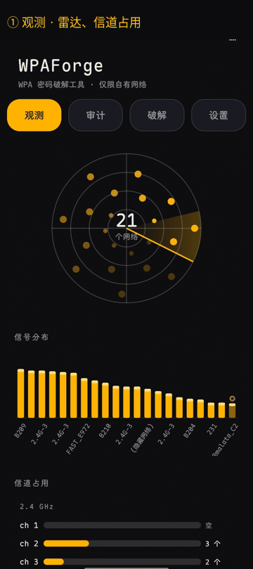
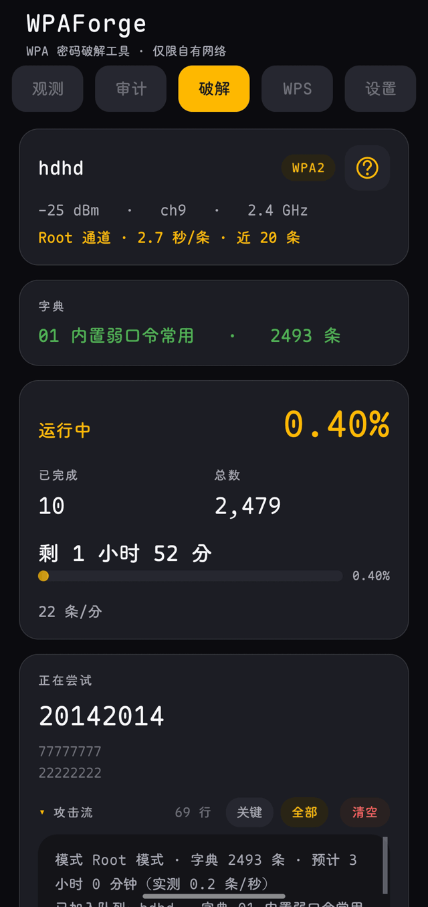
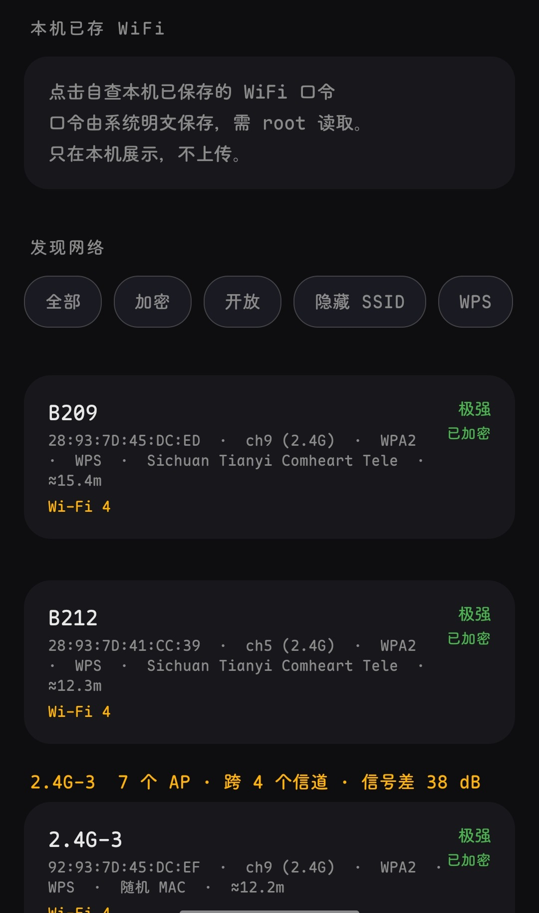
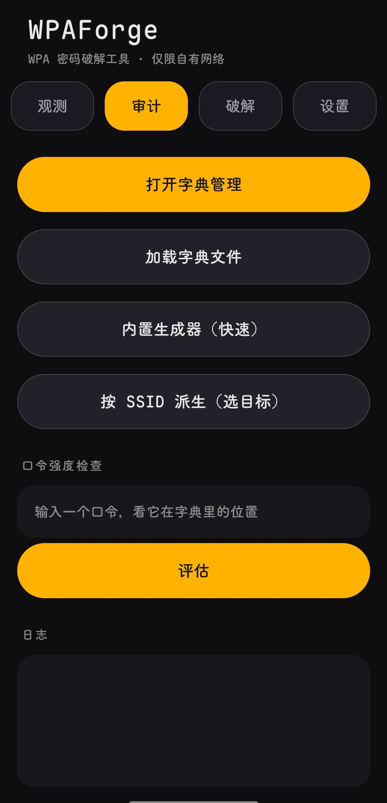

<div align="center">

# WPAForge ⚡

**Crack the WPA password of the router in front of you — right on your phone.**

[](https://github.com/wlmosv-png/wpaforge/releases/latest)
[](https://github.com/wlmosv-png/wpaforge/releases/latest)
[](https://github.com/wlmosv-png/wpaforge/stargazers)
[](LICENSE)
[]()
[]()

**English** · [中文](README.md)




<a href="https://www.bilibili.com/video/BV1b1np6YE7U"></a>

</div>

---

## How it finds the password

No dictionary grind. It guesses first — a few hundred candidates built from what this
particular router is likely to have been set to, ranked, then tried top-down. The
dictionary is the fallback, not the main act.

**The guesses have evidence behind them.** For an SSID like `FAST_E972` it builds
`fast2026`, `FAST#2026`, `e972e972`, `fast@2026` on the spot — none of which exist in
any ready-made list. The vendor name comes from the IEEE OUI registry (419 KB,
15,913 entries shipped inside the APK); when a BSSID isn't in the table the field
stays empty rather than showing a made-up brand.

**Every candidate costs a real association attempt.** A fast AP answers in about a
second, a slow one takes five or more. A phone can hold only one association at a
time — an Android limit, not something to work around — which is exactly why
candidate quality beats quantity: a hundred thousand blind attempts is measured in
days, a few hundred targeted ones usually finish in minutes.

**Success has exactly one definition: a completed 4-Way Handshake.** SSID, supplicant
state and IP must all come from the *same line* of output; miss one and it does not
count. netId is *attribution evidence*, not a requirement: only when both this attempt
and the status frame report a valid non-zero netId that disagree does the result drop
to "unconfirmed" (neither a success nor a wrong passphrase); missing or zero netId never
vetoes. It would rather report "uncertain" than report a false hit — that rule came from
an incident where the system popped "could not connect to BTWIFL_0923" while the app
claimed it had connected.

**Lock the screen and it keeps going; kill it and it resumes.** Progress is persisted
continuously (throttled to at most one write per 20 attempts).

## What else is in there

- Multi-target queue: a list of targets runs in order, each pausable / resumable
- LAN recon: after associating, sweeps the subnet for live hosts and common ports,
  groups them by vendor, writes an exportable report
- Observe tab: channel-occupancy chart with a suggested channel, bandwidth and Wi-Fi
  generation, filterable by WPS
- Connection control: pin one AP with `-b` when several share an SSID; optionally use
  a fresh random MAC per attempt
- Self-audit: reads the WiFi networks saved on the phone and ranks their passphrases
  against common-password lists
- WPS attack (its own tab): decides whether an AP can be attacked at all during the scan,
  keyed on `km=WPS` / `WPS-M2D`. Four candidate layers — vendor BSSID→PIN algorithms, a
  built-in weak-PIN table, your own imported list, full enumeration — plus a halving
  attack and resumable state
- Offline verification: import `.cap` / `.hc22000`, both the EAPOL and PMKID paths —
  10,000 candidates in about 37 s on this phone
- Dictionary management: content search (contains / prefix / suffix / regex), long-press
  multi-select merge, large dictionaries no longer lose data on edit

## Install

> **Root required** · Android 8.0+

[**⬇️ Download latest APK**](https://github.com/wlmosv-png/wpaforge/releases/latest)

No root, no luck — detection relies on `su + cmd wifi`. The Shizuku and rootless channels were removed
in 1.9.24 (code and dependencies removed): Shizuku needs a binder call per association, and the rootless path (`WifiNetworkSpecifier`)
pops a system dialog for every candidate — neither can carry a dictionary walk.

## Quick start

```text
1. Open "Observe", scan for nearby networks, pick your target
2. Open "Crack", load a dictionary (or let it derive one on the spot)
3. Hit start, lock the screen — the found password gets flagged
```

## Screenshots

<p align="center">
  
  <br>
  
</p>

Audit · Crack — the rest you'll see once you install it.

## Building

No Gradle, two manual stages:

```sh
WP_VERSION_CODE=95 WP_VERSION_NAME=1.9.25 sh 1-aapt2.sh  # device: aapt2 resource compile (version set here)
sh 2-build-dex.sh                                       # desktop: javac + d8 + sign (needs WP_FORGE_KS* vars)
```

Output `build/out/wpaforge-signed.apk`, fully explicit build chain. The defaults inside `1-aapt2.sh`
are only a fallback — always pass the version explicitly for a release, or you will ship a lower version
than what is already online.

---

## Usage boundary

**Use only on networks you are authorized to access** (your own router, labs, authorized pentests). Association attempts against unauthorized networks are illegal, and the router logs your MAC and time.

---

## License

Apache License 2.0 — see [LICENSE](LICENSE)

Design trade-offs and pitfalls (config-reuse false positives, detection timing, `finally` clobbering results) live in [`doc/TECHNICAL-NOTES.md`](doc/TECHNICAL-NOTES.md).

## Star History

<p align="center">
  <a href="https://star-history.com/#wlmosv-png/wpaforge&Date">
    
  </a>
</p>

## My other projects

| Project | What it does |
|---|---|
| **[TGAutoSign](https://github.com/wlmosv-png/TGAutoSign)** | Xposed module for Telegram auto check-in — multi-account slots, group sign-in detection, scheduled plans, themed UI. Manage targets with `/jmb` in any chat. |
| **[apk-index](https://github.com/wlmosv-png/apk-index)** | APK static indexing & reverse-engineering search — parses AXML, indexes each dex, finds hook points by string / signature / structure. MCP-ready. |

---

**If this saved you time, hit ⭐ on the repo — that is the entire wishlist.**
Questions and device-compat reports: [Discussions](https://github.com/wlmosv-png/wpaforge/discussions).
