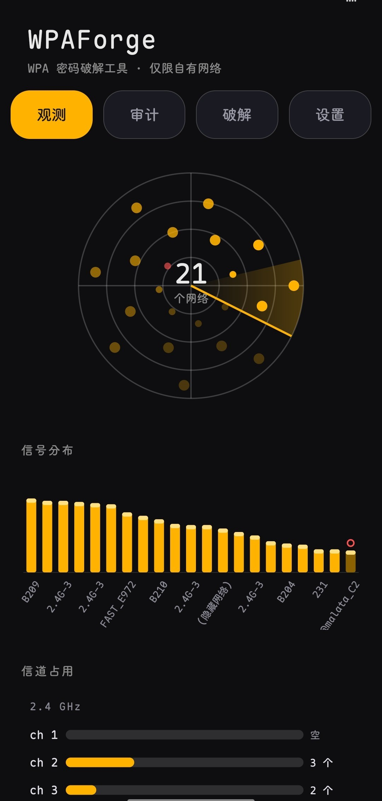
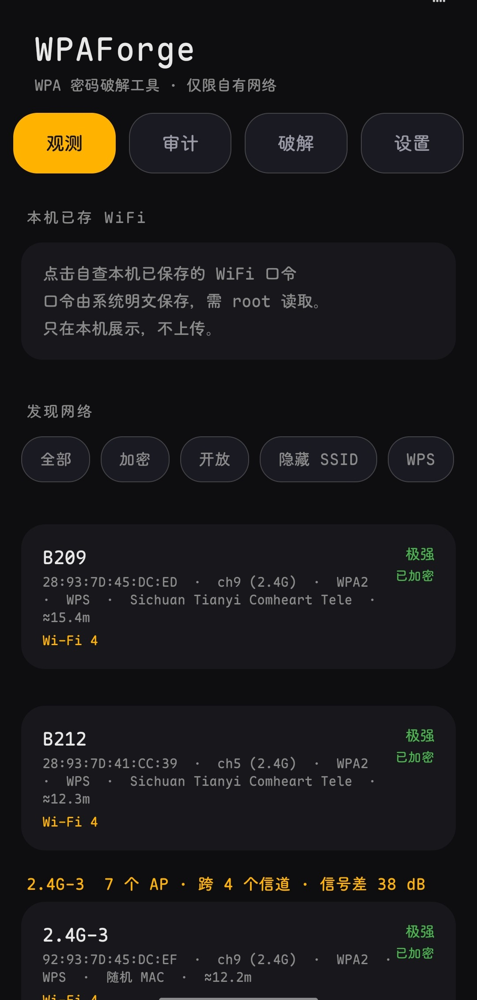
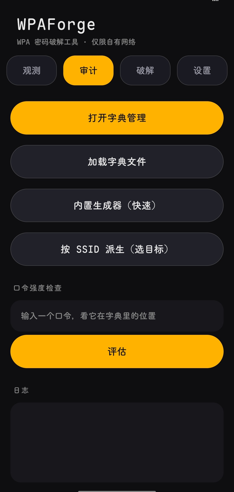

<div align="center">

# WPAForge ⚡

**Crack the WPA password of the router in front of you — right on your phone.**

[](https://github.com/wlmosv-png/wpaforge/releases/latest)
[](https://github.com/wlmosv-png/wpaforge/releases/latest)
[](https://github.com/wlmosv-png/wpaforge/stargazers)
[](LICENSE)
[]()
[]()

**English** · [中文](README.md)



</div>

---

## Why WPAForge

Typical WiFi crackers grind through a dictionary **top to bottom**. WPAForge is different — it builds the most likely passwords **for the one target right in front of you**.

- 🎯 **Target derivation** — generates hundreds of "most likely for this router" candidates from SSID / BSSID, filling what your dictionary lacks
- ⚡ **Smart ranking** — scores and reorders candidates so the right one lands in the first few dozen, not the fifty-thousandth
- 🔄 **Resume** — progress persisted continuously; runs with the screen locked, resumes where it stopped
- 🧵 **Multi-target queue** — runs queued jobs automatically, each pausable / resumable
- 🏭 **Vendor lookup** — built-in IEEE OUI table shows the router brand from its BSSID
- 🔒 **Real-association detection** — one signal only: a completed 4-Way Handshake, four same-source proofs, no false positives

**In one line: dictionary quality beats dictionary size — WPAForge puts "the right one" first.**

## Install

> **Root required** · Android 8.0+

[**⬇️ Download latest APK**](https://github.com/wlmosv-png/wpaforge/releases/latest)

No root, no luck — detection relies on `su + cmd wifi`; the Shizuku and rootless channels were removed (why, see [TECHNICAL-NOTES.md](doc/TECHNICAL-NOTES.md)).

## Quick start

```text
1. Open "Observe", scan for nearby networks, pick your target
2. Open "Crack", load a dictionary (or let it derive one on the spot)
3. Hit start, lock the screen — the found password gets flagged
```

## Screenshots

<p align="center">
  
  
  <br>
  
  
</p>

Network list · Audit · Dictionary · Crack — each page does one job, follows the system language.

## Building

No Gradle, two manual stages:

```sh
sh 1-aapt2.sh       # device: aapt2 resource compile
sh 2-build-dex.sh   # desktop: javac + d8 + sign
```

Output `build/out/wpaforge-signed.apk`, fully explicit build chain.

---

## Usage boundary

**Use only on networks you are authorized to access** (your own router, labs, authorized pentests). Association attempts against unauthorized networks are illegal, and the router logs your MAC and time.

---

## License

Apache License 2.0 — see [LICENSE](LICENSE)

Design trade-offs and pitfalls (config-reuse false positives, detection timing, `finally` clobbering results) live in [`doc/TECHNICAL-NOTES.md`](doc/TECHNICAL-NOTES.md).

## Star History

<p align="center">
  <a href="https://star-history.com/#wlmosv-png/wpaforge&Date">
    
  </a>
</p>

## My other projects

| Project | What it does |
|---|---|
| **[TGAutoSign](https://github.com/wlmosv-png/TGAutoSign)** | Xposed module for Telegram auto check-in — multi-account slots, group sign-in detection, scheduled plans, themed UI. Manage targets with `/jmb` in any chat. |
| **[apk-index](https://github.com/wlmosv-png/apk-index)** | APK static indexing & reverse-engineering search — parses AXML, indexes each dex, finds hook points by string / signature / structure. MCP-ready. |
