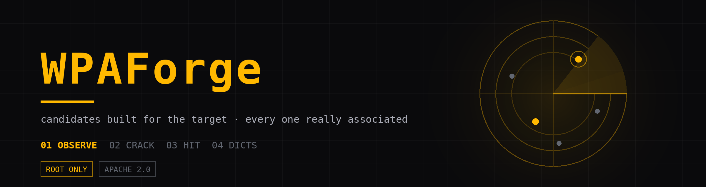
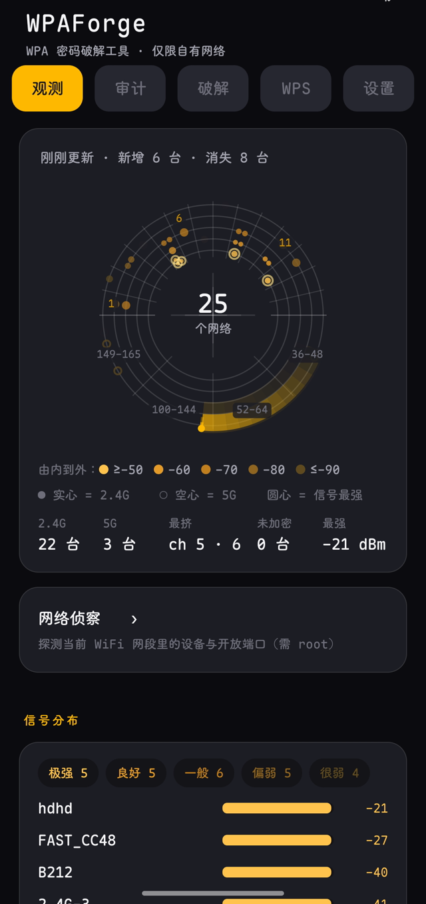
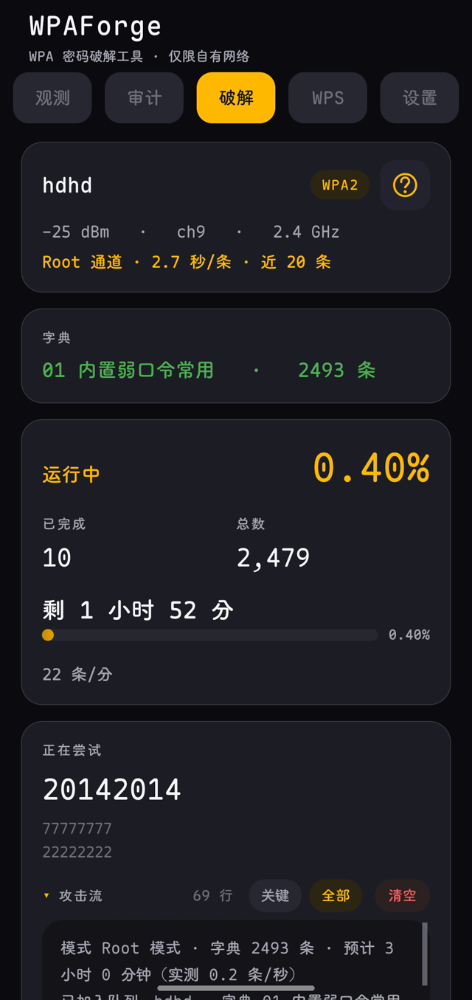
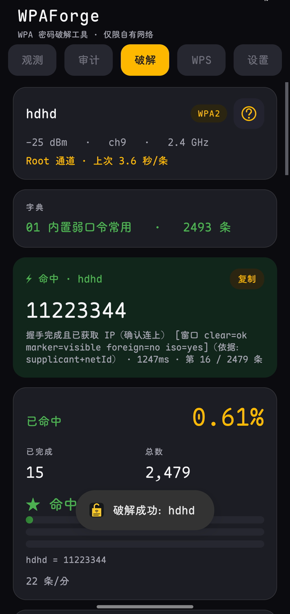
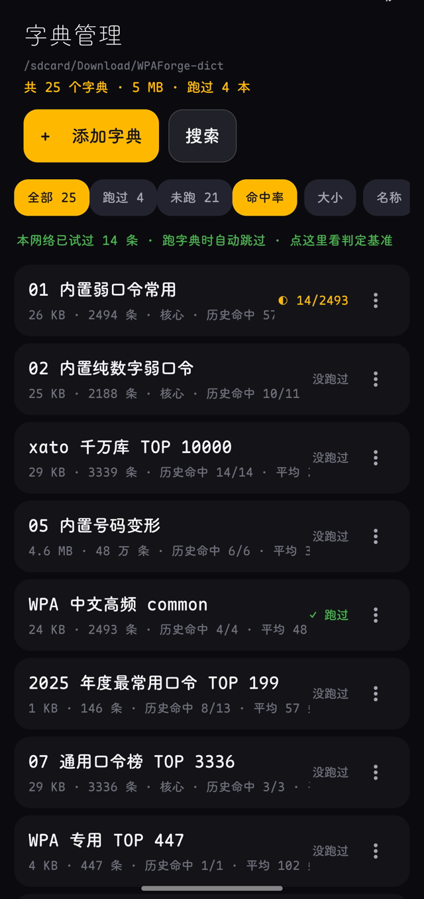
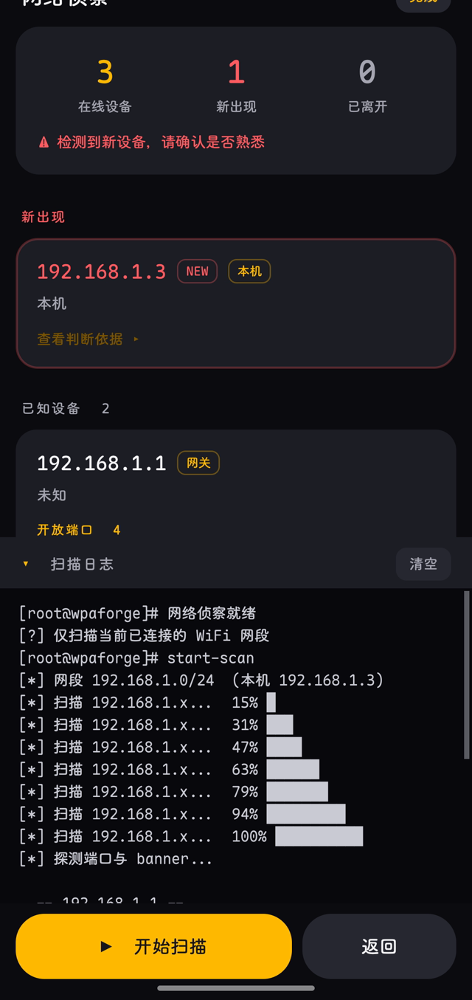
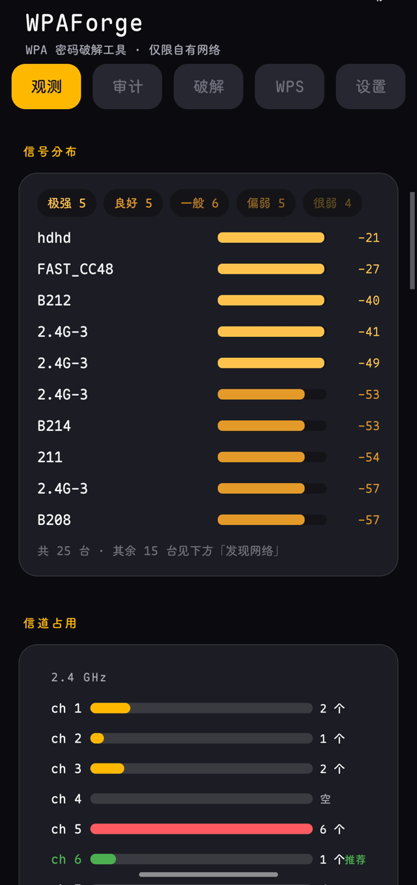
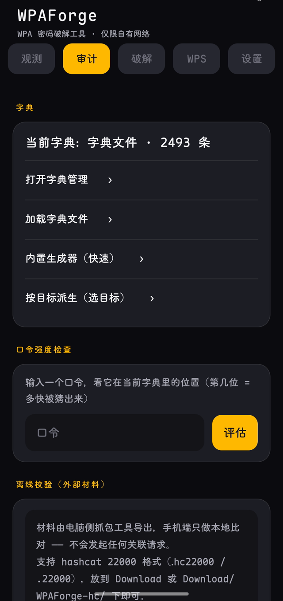
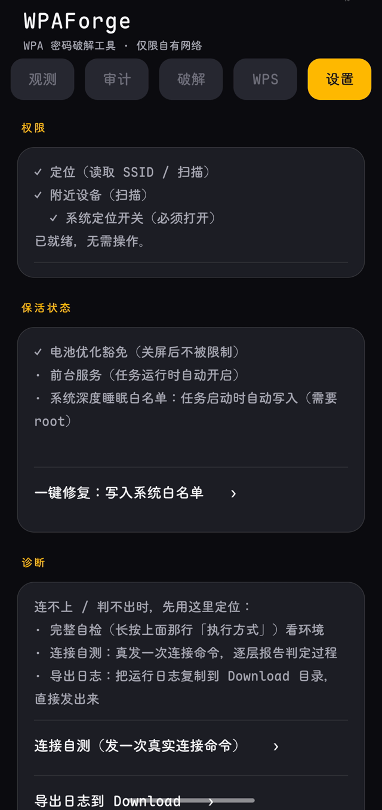

<div align="center">



**辞書を並べて、スマートフォンに 1 冊ずつ順番に試させましょう。**

<sub>複数辞書のプランと自動リレー · 各パスワードはネットワークごとに一度だけ試行 · 対象に合わせて候補を生成 · 一つひとつを実際に関連付けて検証 · 厳選された内蔵辞書、持ち込みも可</sub>

[](https://github.com/wlmosv-png/wpaforge/releases/latest)
[](https://github.com/wlmosv-png/wpaforge/releases/latest)
[](https://github.com/wlmosv-png/wpaforge/stargazers)
<br>
[](https://wlmosv.dpdns.org/wpaforge/)

<sub>[中文](README.md) · [English](README_EN.md)</sub>

</div>

---

> ### 始める前に
>
> - **Root が必要です**（Android 8.0 以上）：判定の処理は `su + cmd wifi` に依存しています。
> - **自分が所有しているネットワーク、またはテストの書面による許可を得たネットワークでのみ使用してください。** 所有していないネットワークへの関連付けの試行は違法であり、AP 側にあなたの MAC アドレスと時刻が記録されます。
> - すべてデバイス上で動作します。何もアップロードされず、復元したパスフレーズは暗号化されてローカルに保存されます。

## 目次

- [できること](#できること)
- [2 つの実行方法](#2-つの実行方法)
- [複数辞書プラン：並べておけば自動で進みます](#複数辞書プラン並べておけば自動で進みます)
- [各パスワードはネットワークごとに一度だけ試す：辞書をまたいだ絞り込み](#各パスワードはネットワークごとに一度だけ試す辞書をまたいだ絞り込み)
- [パスワードの見つけ方](#パスワードの見つけ方)
- [辞書：持ち込みでも、内蔵でも](#辞書持ち込みでも内蔵でも)
- [判定：誤検出より「不確定」を選びます](#判定誤検出より不確定を選びます)
- [よくある質問](#よくある質問)
- [辞書の管理](#辞書の管理)
- [観測：使うべきチャンネルがひと目でわかります](#観測使うべきチャンネルがひと目でわかります)
- [クイックスタート](#クイックスタート)
- [スクリーンショット](#スクリーンショット)
- [他の方法との比較](#他の方法との比較)
- [既知の制限](#既知の制限)
- [インストール](#インストール)
- [ビルド](#ビルド)
- [ライセンス](#ライセンス)

## できること

- **対象ごとに、その場で候補を生成します**：SSID、ベンダー、番地、名前、誕生日、電話番号などをすべて手がかりとして利用できます
- **内蔵辞書でも、自分でインポート／ダウンロードした辞書でも動作します** — どちらもまったく同じように実行されます
- 候補ごとに実際に一度だけ関連付けを行い、候補ごとに判定を返します：**ヒット／パスフレーズが誤り／不確定**
- ランク付けは**あなた自身のローカルの記録**に基づきます：辞書の画面には「ここでは 57/73 ヒット、約 2 回の試行につき 1 ヒット」と表示されます
- 複数対象のキュー：対象のリストが順番に実行され、それぞれ一時停止／再開できます
- **自分の Wi-Fi 設定はそのまま残ります**：破壊的な手順の前に、対象の元の設定を暗号化して記録し、最後に書き戻して読み戻しで確認します。解決しなかったものは「復元状態」に表示され、再試行／破棄できます
- 観測ページ：スペクトラムレーダーに加えて、チャンネルの占有状況とアドバイスを表示します
- LAN 偵察：同じサブネット上の稼働中のホストと一般的なポートを、ベンダーごとにグループ化して表示し、エクスポートできます
- WPS：4 つの候補レイヤー（ベンダーのアルゴリズム／内蔵の脆弱な PIN／カスタムリスト／全列挙）に加え、ハーフハンドシェイク攻撃と再開に対応します
- `.cap` / `.hc22000` のオフライン検証（EAPOL と PMKID の経路。1 万件を約 37 秒）
- 辞書の検索、マージ、編集（含む／前方一致／後方一致／正規表現）
- 画面をロックしたままでも動作を継続し、プロセスが終了させられても復帰します（進捗は永続化されます）

## 2 つの実行方法

| モード | 使いどころ | 動作 |
|---|---|---|
| **単一辞書** | リストが 1 つのとき、または小さく絞ったリストから始めたいとき | 1 つ選ぶ → 終わったら停止 |
| **複数辞書プラン** | 一度に終わらせたいリストが複数あるとき | 並べる → 1 冊ずつ順番に実行し、ヒットで停止、ミスなら次へ進む |

どちらのモードも、同じ判定ロジックと、何を試したかのネットワークごとの同じ記録を共有します。

## 複数辞書プラン：並べておけば自動で進みます

これまでは一度に 1 つの辞書しか実行できず、次の辞書を手で選ぶ必要がありました。
今は複数の辞書をプランにキューイングできます：

- 順番に実行し、**ヒットすると即座に停止**、ミスなら次へ進みます。
- 「自動で次へ」はオン（続行）にもオフ（辞書ごとに停止して判断を委ねる）にもできます。
- プランはクラックページ上でそのまま管理できます（上へ移動／下へ移動／削除）。
- 一時停止、再開、停止に対応します。**すでに完了した辞書は二度と再実行されません**。
- ページには「M 件中 #N ／現在の辞書／次の辞書／全体の進捗」がリアルタイムで表示されます。
- プランが完了・一時停止・ブロックされたとき、ページにはその旨が正確に表示されます。単一辞書の文言を使い回すことはありません。

> **プランは対象ネットワークに紐付きます。** ネットワーク A と ネットワーク B はそれぞれ独自のプランと進捗を持ち、ネットワークを切り替えても混ざることはなく、戻せば前のプランが復元されます。
>
> **プランの実行中は順序を変更できません**（タスクと進捗が同期しなくなるため）：プランマネージャーがまず一時停止か停止を促し、その後は自由に並べ替えられます。

## 各パスワードはネットワークごとに一度だけ試す：辞書をまたいだ絞り込み

同じネットワークでは、**すでに誤りだと証明されたパスワードは、別の辞書でも二度と再試行されません**。

- 辞書を変えても、順序を変えても、辞書を選び直しても、作業が繰り返されることはありません。
- UI には実際の内訳が表示されます：**誤りと証明済み／結果なし／スキップされる／実際にキュー投入**。
- 「スキップされる」件数は、**このプランに実際に存在する**候補から計算され、過去の記録の総数からではありません。

**2 つの段階があり、その境界が明示されます：**

| 段階 | スキップするもの | 決してスキップしないもの |
|---|---|---|
| **保守的（デフォルト）** | **誤りと証明された**候補のみ | 「結果なし」のものはすべて再試行されます |
| **時間節約** | 前回実行され、接続が完了したことは確認できたが、結果が出なかった候補もスキップします | 対象にまだ接続中（判定不能）の候補は、どちらの段階でも決してスキップされません |

「時間節約」を有効にする前に、アプリは**何件がスキップされ、そのうち何件が結果なしだったか**を正確に表示し、前回の実行が弱い電波、ルーターのバックオフ、手動停止に当たっていた場合は、正しいパスワードがその中に含まれているかもしれないという警告を出します。

結論の出なかった結果（タイムアウト、弱い電波、手動停止）は、**決して誤ったパスワードとしては扱われず**、再試行されます。


## パスワードの見つけ方

3 つの方法があります。好きなものを選んでください：

**① 対象向けに生成する。** SSID が `FAST_E972` なら、`fast_e972`、`faste972`、`fast2026` のようなものを生成します。名前、誕生日、電話番号といった手がかりを与えた場合にのみ、`zhangwei1990` や `138xxxxxxxx` を生成します。ベンダー名はアプリ内に同梱された IEEE OUI テーブルから取得し、見つからなければ、でっち上げずに空のままにします。

**② 内蔵辞書を使う。** 厳選された 7 つのテーブル：よくある脆弱なパスワード、数字のみ、WPA のトップリスト、中国語の高頻度、年間トップリスト。それぞれなぜ残しておく価値があるのかが書かれています。開いてみてください。

**③ 自分のものを使う。** txt ファイルをインポートするか、アプリ内のオンラインソースからダウンロードします。内蔵辞書とまったく同じように実行され、独自の記録を積み上げます。

**どの候補も、1 回の実際の関連付けの試行というコストがかかります。** 速い AP は 1 秒で応答し、遅い AP は 5 秒以上かかります。スマートフォンは一度に 1 つのネットワークにしか関連付けできません。これは設計上の選択ではなく Android の制約です。そのため、候補をいくつ持っているかより、*どの*候補を先に試すかのほうがはるかに重要です：10 万回のやみくもな試行は何日もかかりますが、適切に並べた数百回なら、たいてい数分で終わります。

## 自分のネットワークはそのまま残ります

クラックとは対象の設定を繰り返し削除して追加し直すことなので、仕上げの手順が、自分のネットワークが生き残るかどうかを左右します：

- 破壊的な操作の前に、対象の元の設定（封印されたパスフレーズ付き）をローカルの記録に書き込みます。
- 最後に：ヒットした場合はその正しい設定を保持し、それ以外の結果の場合は候補の残骸を削除して元の設定を書き戻し、**読み戻して確認**します。
- 「圏外」「現在は別のネットワークに接続中」「時間内に接続されなかった」は、**復元の失敗ではありません** — 成功は設定が書き戻されたかどうかだけで判定されます。
- 保存済みネットワークの一覧が読み取れない場合は、結論を出しません：記録は保持され、再試行可能で、設定が残っている可能性があるものとして扱われます。
- 解決しなかった記録は、監査ページの**復元状態**の下に一覧表示され、それぞれ再試行、確認、破棄ができます（破棄するのはローカルの記録だけで、システムのネットワーク設定は決して削除しません）。

自動の再試行は間隔を空け（10 分）、回数を制限し（3 回）、その後アーカイブされます。
**同じ対象**に対する新しいタスクは、記録が未解決の間は説明付きで保留されます。

## 辞書：持ち込みでも、内蔵でも

内蔵辞書は厳選されたもので、大量ではありません：数十万行のテーブルは廃止しました。作者自身の端末での 107 件の実際のヒットを通じて、それらが一度もヒットを生まなかったからです。
インポートした辞書は一級市民です — 内蔵辞書と同じように実行され、マージされ、記録を積み上げます。実行後、辞書の画面は次のようになります：

```text
01 built-in common weak       core · hit 57/73 · ~2 attempts per hit
xato top 10000                    hit 14/14 · ~23 attempts per hit
```

デフォルトの並び順はヒット率です：*あなたの*ネットワークで実力を示したテーブルが最初に実行されます。
その記録はローカル履歴の最初の数列からのみ読み取られます — そのためにパスフレーズが復号されることは一切ありません。

## 判定：誤検出より「不確定」を選びます

どの候補も、3 つの判定のいずれかで終わり、それぞれに裏付けとなる証拠があります：

| 判定 | 証拠 |
|---|---|
| **ヒット** | 4-Way Handshake が完了し、SSID／サプリカントの状態／IP が**同じ出力行から**得られている |
| **パスフレーズが誤り** | 観測可能な失敗の証拠（例：AP がハンドシェイクのフレーム 1 を再送する） |
| **不確定** | 何も観測されないまま時間の予算が尽きた — 独自の列を持ち、決して「試行済み」とはカウントされません |

netId は**帰属の証拠としてのみ**使用されます：両者が有効な非ゼロの netId を報告し、かつそれらが食い違う場合に限り「不確定」に格下げします。欠落やゼロが判定を覆すことはありません。

これは実際の失敗から生まれました：初期のビルドで、システムのダイアログが「BTWIFL_0923 に接続できませんでした」と表示する一方で、アプリは「接続済み」と報告したのです。本ツールは、誤ってヒットを報告するくらいなら、ヒットを見逃すほうを選びます。

## よくある質問

### 「このツールは 100% 正しい判定を保証できないのに、なぜ使うのか？」

なぜなら、100% 確実な判定は**そもそも達成不可能**だからです。これは WPAForge に固有の欠点ではなく、問題の本質です：

1. **客観的な制約**：Android のネットワークスタック、ベンダーのドライバー、ルーターのファームウェアの挙動、無線イベントの報告のされ方は、すべてアプリの制御の外にあります。同じルーターでも、時点によって報告が異なることさえあります。
2. **接続要求を発行したからといって、システムが期待どおりに動いたとは限りません**。また、**接続が失敗したからといって、必ずしもパスワードが誤っているとは限りません** — ドライバーのタイムアウト、ルーターのバックオフ、チャンネルの変更、干渉のこともあります。
3. WPAForge の設計ルールはこうです：**帰属できる証拠があるときにのみ確定的な結論を出し、そうでなければ「不確定」のままにする。**
4. 「不確定」は確定した失敗として提示されることは決してなく、候補を永久に除外することもありません — 再試行されます。確定的な失敗は、前の回から持ち越されたものではなく、**この**試行に帰属できなければなりません。

ですから、得られるのは「100% の判定」ではなく、次のものです：

- **誤った帰属が減る** — 1 回の環境ノイズのせいで正しいパスワードが消されることがありません。
- **誤った除外が減る** — 不確定な候補が永久にスキップされることがありません。
- **繰り返し作業が減る** — このネットワークですでに誤りと証明されたパスワードが、別の辞書で再び現れることがありません。

**裏付けのない失敗を事実として提示するより、不確実さを認めるほうがよいのです。**

## 辞書の管理

- 各行に、エントリ数、実行状態、プランへの所属が直接表示されます。
- 複数選択して、**プランへの一括追加／削除**ができます。プランカードはデフォルトで折りたたまれています。
- **削除はゴミ箱に入ります** — 復元でき、そこから完全に削除することもできます。
- エディターには**行番号のガター**、カーソルの行／列、指定行へのジャンプ、検索があり、数千行でも正確に位置を特定できます。
- **内容による辞書の再開**：辞書の名前変更、移動、再インポートの後は、**内容で**照合されます — 内容が同一なら中断したところから再開し、内容が本当に変わっていればその旨を表示し、古い位置を**引き継ぎません**。

## 観測：使うべきチャンネルがひと目でわかります

ダイヤルそのものがスペクトラムです：上半分は 2.4G の 14 チャンネル、下半分は 5G の 4 バンド。半径は信号強度で、最も強いものが中心に最も近くなります。**1 つのセクターにドットが多く集まるほど、そのチャンネルが混み合っています。**

その下には、自分で何も数えなくてよい結論が出ます：

```text
2.4G 25   5G 4   busiest ch 5 · 7   open 0   best -20 dBm
```

ヘッダーは 1 行です — `Updated just now` / `Updated Ns ago`。デバイスが現れたり離れたりすると `+2 new · -1 gone` のように拡張されます。

## クイックスタート

```text
1. Open "Observe", scan for nearby networks, pick your target
2. Open "Crack": let it generate candidates, or load a built-in / your own dictionary
3. Hit start, lock the screen — the passphrase is flagged and can be copied with one tap
```

## スクリーンショット


<sub>UI 概要 — 観測 → クラック → ヒット → 辞書の 4 ステップ（1 フレーム 2 秒）</sub>

<p align="center">
  
  
  
  
</p>
<p align="center">
  
  
  
  
</p>
<p align="center"><sub>① 観測（スペクトラムレーダー） · ② クラック（進捗と速度） · ③ ヒット（パスフレーズ + ワンタップコピー） · ④ 辞書（ヒット率順、ローカルの記録付き）<br>⑤ LAN 偵察（デバイスと開いているポート） · ⑥ 信号の分布とチャンネルのアドバイス · ⑦ 監査（復元状態／辞書／強度／オフライン検証） · ⑧ 設定（権限とキープアライブ）</sub></p>

> **注**：これらのスクリーンショットは v1.9.22 の UI です。辞書管理ページ、複数辞書プランのカード、ゴミ箱は後から追加されたもので、撮り直していません。モックアップや合成画像はここには置いていません。

## 他の方法との比較

| アプローチ | 必要なもの | 速度 | 手間 |
|---|---|---|---|
| **WPAForge** | root 化したスマートフォン 1 台 | 候補はその場で生成。数百件ならたいてい数分 | スタートをタップ |
| PC 上の aircrack-ng + キャプチャ | ノート PC、モニターモード対応アダプター、すでにキャプチャ済みのハンドシェイク | ワードリスト次第。大きいものは何日もかかる | コマンドライン、キャプチャ作業 |
| スマートフォン上の Termux スクリプト | Linux 環境、外付けアダプター | ほぼ aircrack のラッパー | 面倒なセットアップ |
| オンラインのクラックサイト | ハンドシェイクを他人に渡す | 順番待ち | キャプチャが自分のマシンから出ていく |

家庭用ルーターで人々が実際に設定するパスワードには強いです。ランダムな 12 文字のパスフレーズは対象外です — それは WPA3 の出番です。

## 既知の制限

| 症状 | 原因 | 対処 |
|---|---|---|
| 試し続けるが、ヒットしない | パスフレーズが候補の集合に含まれていない | 自分の辞書をインポートするか、候補の予算を増やす |
| すべてが即座に失敗する | 対象が WPA3 / PMF、または WPA2-WPA3 遷移 | 関連付けの試行だけでは通過できない |
| 一部の AP が表示されない | スマートフォンが 6GHz 非対応、またはランダム MAC がオン | ランダム MAC をオフにして再スキャン |
| 権限エラー | Root が付与されていない、または ROM が `cmd wifi` をブロックしている | 設定ページの 6 ステップのセルフチェックを実行する |
| 実行の途中で終了させられる | バッテリー最適化 | ホワイトリストに追加する。進捗は永続化され、再開します |
| 仕上げで「元のパスフレーズが利用できません」と出る | 封印されたパスフレーズが失われた（Keystore が利用不可、デバイスの変更、データの消去） | 手動で再接続する。記録が復元状態の下に理由を説明します |
| プランが現在のネットワークしかカバーしない | プランは**対象ネットワークに紐付いている** | 切り替えた後、そのネットワーク用にプランを組む |
| 実行中にプランを並べ替えられない | 実行中の並べ替えはタスクと進捗の同期を崩す | まず一時停止か停止し、その後に並べ替えて続行する |
| 「時間節約」をオンにすると、一部のパスワードが再試行されない | その段階は、結果なしで実行された候補をスキップする | 不安定なネットワークでは使わない。オフにするか、強制再実行を使う |
| WPS の対象が「能力不明」と表示され、デバイス名が出ない | SELinux がサプリカントから root ドメインへの応答を許可していない | allow ルールを 1 つ追加する（下記参照） |

### WPS チャンネル（Root が必要）

報告された WPS のデバイス名、構成方式、ペアリングウィンドウを読み取るには、制御チャンネル経由で wpa_supplicant に問い合わせます。一部のシステム（実測：ColorOS 15 / Android 15）では、SELinux がサプリカントから root ドメインへ応答を送り返すことを許可しないため、AP の一覧は得られても「能力不明」となり、デバイス名が出ません。WPAForge は、黙って「すべて正常」と表示する代わりに、WPS ページでその旨を伝えます。

対処：起動時にルールを注入する実行可能なスクリプトを `/data/adb/service.d/` に置きます：

```sh
#!/system/bin/sh
/data/adb/magisk/magiskpolicy --live \
  "allow hal_wifi_supplicant_default magisk unix_dgram_socket sendto"
```

スクリプトを削除すれば元に戻ります。

> **注**：モジュールの `sepolicy.rule` ファイルは、この環境では**機能しませんでした**（実測） — 再起動後もライブポリシーにルールがなく、`BSS_ENUM` が 0 にフォールバックしました（原因不明）。`magiskpolicy --print-rules | grep "hal_wifi_supplicant_default magisk"` で確認してください。

## インストール

> **Root が必要** · Android 8.0 以上

[**⬇️ 最新の APK をダウンロード**](https://github.com/wlmosv-png/wpaforge/releases/latest)

Root が必須の理由：判定の処理には `su + cmd wifi` が必要です。Shizuku と非 root のチャンネルは 1.9.24 で（コードごと）削除されました：Shizuku は接続のたびに binder を借用し、非 root の `WifiNetworkSpecifier` の経路は候補ごとにシステムダイアログを表示します — どちらも候補ごとの辞書スイープには耐えられません。

## ビルド

Gradle は使いません。2 段階の手動チェーンです：

```sh
WP_VERSION_CODE=157 WP_VERSION_NAME=1.9.61 sh 1-aapt2.sh  # device side: aapt2 resource compile (version set here)
sh 2-build-dex.sh                                       # desktop side: javac + d8 + signing (needs WP_FORGE_KS*)
```

出力：`build/out/wpaforge-signed.apk`。`1-aapt2.sh` のバージョンのデフォルト値はあくまでフォールバックです — リリースでは明示的に渡さなければ、遅れたバージョンをビルドしてしまいます。

## フィードバック

デバイスの互換性、失敗する AP の特性、機能のアイデア → [Discussions](https://github.com/wlmosv-png/wpaforge/discussions)。
確認済みのバグ → [issue テンプレート](https://github.com/wlmosv-png/wpaforge/issues/new/choose)。

---

## 利用範囲

**テストの許可を得たネットワーク**（自分のルーター、ラボ、許可されたペネトレーションテスト）でのみ使用してください。所有していないネットワークへの関連付けの試行は違法であり、AP があなたの MAC アドレスと時刻を記録します。

## ライセンス

Apache License 2.0 — [LICENSE](LICENSE) をご覧ください。

設計上のトレードオフと、その背後にあるバグ（設定の再利用による誤検出、判定のタイミング、`finally` による結果の上書き）は [`doc/TECHNICAL-NOTES.md`](doc/TECHNICAL-NOTES.md) にあります。

---

**これが役に立ったなら、リポジトリへの ⭐ が機能要望リストのすべてです。**

## Star 履歴

<p align="center">
  <a href="https://star-history.com/#wlmosv-png/wpaforge&Date">
    
  </a>
</p>

## 私の他のプロジェクト

| プロジェクト | 内容 |
|---|---|
| **[TGAutoSign](https://github.com/wlmosv-png/TGAutoSign)** | Telegram の自動チェックイン用 Xposed モジュール — アカウントスロット、グループのチェックイン判定、スケジュール、テーマ。任意のチャットで `/jmb` を送ると対象を管理できます。 |
| **[apk-index](https://github.com/wlmosv-png/apk-index)** | 静的な APK インデックスとリバースエンジニアリング検索 — AXML 解析、dex ごとのインデックス、文字列／シグネチャ／構造でのフック地点の検索、MCP インターフェース。 |
